<div align="center">


# LỌ CHÉO — PICKLED JAR SHOWDOWN

### 🫙 Vietnamesisches Pickle-Arcade, zu 100% im Browser — eine einzige, in sich geschlossene HTML-Datei, offline-first
### 🌐 Spiel-UI in 7 Sprachen — Tiếng Việt · English · 中文 · 日本語 · 한국어 · Español · Français

[🇻🇳 Tiếng Việt](README.md) · [🇬🇧 English](README.en.md) · [🇨🇳 中文](README.zh.md) · [🇯🇵 日本語](README.ja.md) · [🇰🇷 한국어](README.ko.md) · [🇪🇸 Español](README.es.md) · [🇫🇷 Français](README.fr.md) · [🇹🇭 ไทย](README.th.md) · [🇩🇪 Deutsch](README.de.md) · [🇵🇹 Português](README.pt.md)

[](docs/releases/v1.1.8.md)
[]
[]
[](https://github.com/standardizeparadigm/Lo-CheoIO/actions/workflows/ci.yml)
[](LICENSE)
[](#-installieren--starten)
[](#-produktions-build)
[](#-sprachen-wechseln)
[](CONTRIBUTING.md)




</div>

---

## 🥒 Worum es geht

> Lọ Chéo — Pickled Jar Showdown: ein Pickle-Arcade, der zu 100% im Browser läuft, verpackt in einer einzigen, in sich geschlossenen HTML-Datei, offline-first — kein CDN, kein Server. Das Keramikglas kennt nur EINE Bewegungsrichtung: diagonal. Halte zwei Tasten, um schräg zu laufen, zu beschleunigen und Schimmel, Fliegen und Raupen zu zerfetzten — und fülle das Glas, bevor die Keramik in drei Stücken platzt. **9 Modi · 14 Zutaten · 16 Erfolge · TOP-8-Rangliste · UI in 7 Sprachen.**

Das hier ist ein **Ein-Bildschirm-Action-Arcade** nach dem Vorbild des schlichten vietnamesischen eingelegtes Gemüses. Keine linearen Level, keine überladenen Menüs — nur das Glas, ein endloser Regen aus Gemüse und deine feurigen Reflexe.

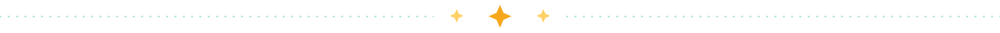

## 🆕 Neu in v1.1.8

> Der **letzte Patch** vor 1.2.0. Kein neuer Modus, keine Balance-Änderung, kein neues Speicherformat. Diese letzte Runde tut eines: **der Hero misst das Fenster und wählt sein eigenes Layout** — bei jeder Größe, ohne Scrollen und ohne Abschneiden. Das Deck-Band entfällt, alle 20 SVGs sind neu gezeichnet.

### 📐 Eine Addition, die niemand verwaltete — und vier Fehler auf einmal

Der Screenshot meldete vier Probleme, aber sie hatten genau **eine** Ursache. Die Ecken-Panel-Reihe und der Ticker waren `shrink-0`-Flex-Geschwister des Hero: Sie nahmen ihre Höhe zuerst, und nur der Rest ging an den Hero:

```
720px Fenster
├── 415px   GAME/INFO-Panel-Reihe   (Höhe nach Inhalt, shrink-0)
├──  55px   Ticker                  (Höhe nach Text, shrink-0)
└── 250px   Hero                    ← der Rest, bei ~430px Bedarf
```

| Symptom im Screenshot | Warum |
| --- | --- |
| `LỌ` an der Oberkante abgeschnitten | Hero 250px, Inhalt 430px |
| `CÀI ĐẶT` läuft aus dem Panel | Panel bemaß sich nach Inhalt, nicht nach Fenster |
| Copyright-Zeile in zwei Hälften | Ticker brauchte 55px, bekam 48px |
| Das `×` der «Spielanleitung» schwebte mitten im Bild | das Accordion, das es hielt, war längst weggescrollt |

Die Lösung war nicht, ein paar Pixel Luft dazuzugeben, sondern **die Höhe einmal zu deklarieren und alles daraus zurückzulesen**: `layout/metrics.ts` besitzt jede Zahl, `layout/fit.ts` liefert einen reinen `MenuPlan`, `MenuChrome` ist ein einziges `absolute inset-x-0 bottom-0`-Band, und der Hero reserviert seinen Platz mit einem `padding-bottom`, das die **gleiche** Funktion berechnet.


### 🌀 Der Scroll-Fehler: ein Scroll-Bereich im Scroll-Bereich

Unten stand still, oben ließ es sich weiter auf und ab ziehen — genau wie beschrieben. v1.1.7 wickelte den Hero-Inhalt in eine `overflow-y-auto`-Box und zentrierte ihn mit `min-h-full` + `justify-center`. Das stimmt nur, solange der Inhalt **niedriger** ist als die Box; ist er **höher**, schiebt `justify-center` ihn nach oben, und seine Oberkante liegt *oberhalb des Scroll-Ursprungs* — keine Scroll-Position erreicht sie.

Jetzt hat der ganze Bildschirm **einen** Scroll-Bereich (`.menu-scroll`), Inhalt an der Oberkante verankert, nie vertikal zentriert. Die drei Klassen, die den Fehler verursachten — `flex-1 overflow-y-auto`, `min-h-full`, `justify-center` — sind durch `tests/menu-layout.test.ts` verboten.

### 🎯 Hero: `LỌ CHÉO` mittig, ein Stück nach oben

- Der Schriftzug wird **horizontal zentriert** und dann **angehoben**, wie gewünscht, mit einer Größe, die gegen **Breite und Höhe** zugleich begrenzt ist, damit ein niedriges Fenster die Glyphe nicht überlaufen lässt.
- Das Keramikglas sitzt rechts, umgeben von **drei Halo-Ringen auf 18s / 26s / 34s** — der einzelne 14s-Ring las sich wie ein Lade-Spinner.
- **Vierzehn Deko-Elemente** (Sterne, Funken, Ringe, Blasen, Chilis, Limettenblätter, Fliegen, Fischsaucen-Tropfen) in zwei Bändern über und unter dem Titel, jedes mit eigener Dauer und Verzögerung — die Antwort auf *„nur der Schriftzug und das Glas ist zu wenig"*.
- Die Koordinaten sind **Daten** in `scene/decor.ts` mit Kollisionsprüfung, daher fixiert `tests/menu-decor.test.ts` Lage und Anzahl.

### 📖 «Spielanleitung» zieht ins GAME-Menü

Die sechs Regeln und die Tastentabelle liegen nicht mehr im Hero — sie zu öffnen schob den Schriftzug aus dem Bild. Sie sind jetzt **eine Zeile im GAME-Panel**, die ein Modal öffnet (`HowToModal`): Das Layout bewegt sich weder offen noch geschlossen. Das verirrte `×` verschwand mit dem Accordion, das es erzeugte.

### 🗂️ Das Projekt bekommt weitere Ordner

```
src/components/menu/
├── layout/          metrics.ts · fit.ts · useMenuPlan.ts       ← NEU: jede Zahl an einem Ort
├── scene/           decor.ts · DecorGlyph · HeroDecor · JarHalo ← NEU: der dekorierte Hero
├── ticker/          strings.ts · tickerTone.ts · MenuTicker     ← NEU: das Band als Modul
├── howto/           rules.ts                                    ← NEU: 6 Regeln + Tastentabelle
├── background/      layers.ts · MenuBackground                  ← 8 Hintergrund-Ebenen als Daten
└── MenuChrome.tsx · HowToModal.tsx                              ← NEU: das untere Band + Modal
```

### 🐛 Fehlerbehebungen

| # | Fehler | Behebung |
| --- | --- | --- |
| 1 | Oben scrollte es weiter, unten stand alles | verschachtelte Scroll-Box raus — **ein** oben verankertes `.menu-scroll` |
| 2 | `LỌ` an der Oberkante abgeschnitten | Hero behält eine 342px-Szene statt auf 250px gepresst zu werden |
| 3 | `CÀI ĐẶT` läuft aus dem GAME-Panel | `CornerPanel.height` ist jetzt **Pflicht**: 318px (kompakt) / 458px (reich) |
| 4 | Copyright-Zeile in zwei Hälften | Ticker fest 48px, Copyright im selben Block wie die Laufschrift |
| 5 | `×` der «Spielanleitung» schwebte mitten im Bild | Accordion → Modal, nichts `absolute` auf einer weggescrollten Box |
| 6 | Panelhöhe folgte der Übersetzungslänge (Deutsch und Thai liefen vor Englisch über) | deklarierte Höhe, unabhängig vom Inhalt |
| 7 | Ein 14s-Halo-Ring las sich als Spinner | drei Ringe auf 18s / 26s / 34s, die fast nie gleichphasig sind |
| 8 | Doku/SVGs/Launcher hinkten der Version hinterher | kompletter Durchlauf 10 READMEs + Docs + 19 SVGs → 1.1.8 |

→ Vollständige Details: [docs/releases/v1.1.8.md](docs/releases/v1.1.8.md) · Vorherige Version: [docs/releases/v1.1.7.md](docs/releases/v1.1.7.md)

### 🪟 Zwei Aufnahmen, ein Fenster, 260 Pixel Unterschied

Die letzten beiden Aufnahmen dieser Runde zeigen **dieselbe Anwendung**: `1920×1080` im Vollbild und `1920×820` im Fenster. Die Breite hat sich um keinen Pixel geändert. In der zweiten liegt die untere Hälfte des Hero jedoch **unter** den beiden Eckpanels, und der Chip `CHẾ ĐỘ CHƠI` ist halbiert.

Die Ursache ist nicht fehlende Höhe, sondern die falsche Frage:

| Was das Layout entscheidet | Weiß | Weiß nicht |
| --- | --- | --- |
| `sm:` · `lg:` in CSS | die **Breite** | die **Höhe** |
| `plan.minimal` | die **Höhe** (unter 220px) | die Breite, und erst wenn es zu spät ist |
| `heroLayout()` (neu) | **beides**, aus derselben Zahl, die das Chrome nutzt | — |

Eine Entscheidung, die von *zwei Achsen* abhängt, lässt sich nicht als einachsige Media Query schreiben. Das Hero-Layout verlässt also das CSS und wird eine reine Funktion: `heroLayout({ scene, width, minimal })`.

`scene` ist die Höhe, die `planMenuLayout()` dem Hero zugewiesen hat — **genau die Zahl**, die das Chrome reserviert. Sie kann nicht abweichen, weil beide aus einer Funktion lesen.

#### Drei Schwellen, alle drei abgeleitet

| Konstante | Wert | Abgeleitet aus |
| --- | --- | --- |
| `HEIGHT_FOR_BADGE_ROW` | **232** | Wordmark 150 + Badge 40 + Live-Badge 22 = 212, plus 20px Luft |
| `HEIGHT_FOR_HALO` | **300** | Lockup 150 + Halo-Ring 240 − Überlappung 90 |
| `HEIGHT_FOR_SIDE_BY_SIDE` | **300** | die höhere Spalte: Maskottchen 192 + Chip 24 + Rand |

`232` ist ein **gefangener Bug**: Der erste Entwurf setzte `210` — unter dem 212px-Lockup, das er steuert. Ein 210px-Band zeichnete dann ein 212px-Lockup, und die Rekordzeile wurde abgeschnitten. Genau die Fehlerklasse dieser Runde, erzeugt durch die Korrektur selbst.

`tests/menu-adaptive.test.ts` prüft **1.682 Viewports** und verlangt `heroContentHeight(layout) ≤ scene` bei jedem Sample.

#### Das vierte fehlende Ereignis

Der Nutzer erzeugte diese beiden Aufnahmen durch **Drücken der Vollbildtaste**. Die App lauschte auf `resize` und `orientationchange`. Firefox feuert beim Vollbildwechsel keines von beiden; älteres Safari nur `webkitfullscreenchange`. Also änderte sich die Fensterhöhe, der Hero behielt seinen alten Plan, und der Chip blieb abgeschnitten.

`VIEWPORT_EVENTS` bündelt alle sechs Schreibweisen an einer Stelle, weil `useMenuPlan()` und `useViewportWidth()` sie **beide** brauchen — jede registrierte zuvor ihre eigene Kopie, also zwei Kopien, die zwei verschiedene Fenster beschreiben können.

### 🗑️ Das Trennband aus Bild 12 — und das Deck, das mitging

Das dritte Bild ist ein `1443×180`-Streifen aus der Bildmitte: ein `🎮`-Marker, eine goldene Linie, dann drei Überschriften `GAME / HEUTIGE HERAUSFORDERUNG / TAGESREGEL`. Das ist das **Deck** — drei Textspalten in einem Band fester Höhe.

Es kann dort nicht leben, und die beiden anderen Aufnahmen sagen warum: bei `1920×1080` wurde die rechte Spalte **mitten im Satz** abgeschnitten, bei `1920×820` lag die ganze Reihe unter den Panels. Ein Band, das hoch genug für ein 200px-Wordmark ist, ist es nicht auch für drei Absätze.

Nichts, was das Deck sagte, geht verloren:

| Was das Deck sagte | Wo es jetzt lebt |
| --- | --- |
| der gewählte Modus | der Chip unter dem Maskottchen; die volle Liste in GAME |
| **die heutige Herausforderung** | eine Zeile im INFO-Panel — `Modus · Ziel` |
| die Tagesregel | eine Zeile des Anleitungs-Modals, das immer die vollständige Fassung dieser sechs Regeln war |

Die Datumsrechnung ist **nicht** mitgegangen: `challengeFor()` und `tipIndexFor()` zogen nach `src/game/daily/`, mit ihren 21 Tests und ihren Namen.

Das leere Band unter dem Wordmark ist jetzt **Absicht**. Das ist der Preis eines Hero, der bei jeder Größe passt.

### 🏷️ Changelog in Stufen — eine Farbe pro Stufe

| Stufe | Label | Farbe | Bedeutung | Beispiel |
| --- | --- | --- | --- | --- |
| `major` | **MAJOR** | 🩷 Pink `#ff5fb0` | große Version — neue Systeme | 1.0.0 |
| `minor` | **UPDATE** | 🟡 Gold `#f5a81c` | Ausbau — neue Inhalte | 1.1.0 |
| `patch` | **PATCH** | 🟣 Violett `#9d6bff` | Fehlerbehebungen und Aufräumen | 1.1.1 → **1.1.8** |

Die Stufe wird von `tierFor(version)` **aus dem SemVer abgeleitet**, nie getippt. Das Panel hat einen **Filter**: ALLE · MAJOR · UPDATE · PATCH samt Anzahl je Stufe.

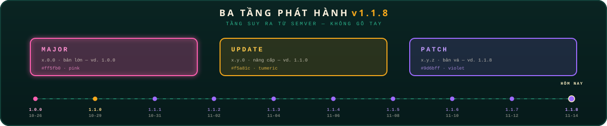

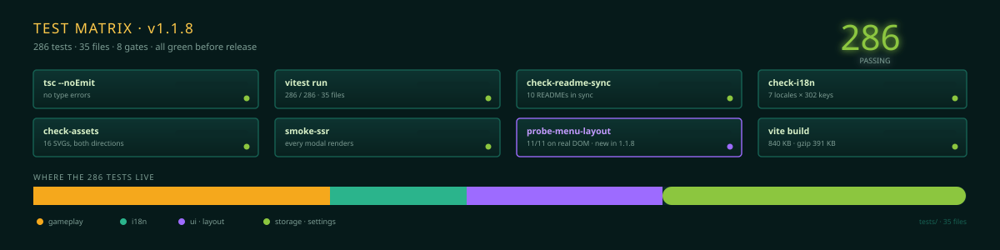



## 📐 Adaptives Layout — wie der Hero seine Form wählt

Der Startbildschirm entscheidet sein Layout nicht über Media Queries. Er **misst** das Fenster und wählt aus fünf Fähigkeiten: `sideBySide`, `halo`, `badgeRow`, `mascot`, `liveBadge`.

```
planMenuLayout(viewport) → { scene, reserve, … }    scene + reserve = Höhe
            │
            └─ scene ist genau die Zahl, die das Chrome reserviert
                        │
    heroLayout({ scene, width }) → 5 Booleans
```

| Flag | Aktiv wenn | Was ohne es fehlt |
| --- | --- | --- |
| `sideBySide` | Breite ≥ 1024 **und** Hero ≥ 300px | das Maskottchen rutscht unter das Wordmark |
| `halo` | Hero ≥ 300px | der Ring um das Glas |
| `badgeRow` | Hero ≥ 232px | die Plakette «HŨ DƯA ĐẠI CHIẾN» und die Rekordzeile |
| `mascot` | fast immer | — (nur in der minimalen Ökonomie verborgen) |
| `liveBadge` | Hero ≥ 232px | die Zeile LIVE AUS DER KÜCHE und die Version |

Die drei Schwellen sind **keine runden Zahlen** — jede entspricht der realen Höhe dessen, was sie steuert:

```ts
HEIGHT_FOR_BADGE_ROW    = 232  // 150 Wordmark + 40 Plakette + 22 Live + 20 Luft
HEIGHT_FOR_HALO         = 300  // 150 Lockup + 240 Ring − 90 Überlappung
HEIGHT_FOR_SIDE_BY_SIDE = 300  // höhere Spalte: 192 Maskottchen + 24 Chip
```

`tests/menu-adaptive.test.ts` prüft **1.682 Viewports** und verlangt `heroContentHeight(layout) ≤ scene` bei jedem Sample. Beim Größenändern hören beide Hooks auf **sechs** Events und aktualisieren in einem Frame.

## ✨ Die Highlights

| Bereich | Details |
| --- | --- |
| 🎮 **9 Spielmodi** | **KLASSISCH EINGELEGT** (ausgewogen) · **ZEN** (keine Gefahren, ×0.5) · **CHILI-INFERNO** (+35% Tempo, ×1.5) · **60-SEKUNDEN-RUSH** (Time-Attack 60s, ×1.25) · **GOLDRAUSCH** (goldene Beute ×2.6) · **Eingelegter Regen** (~1.4× dichter, ×0.75) · **Dünnes Keramik** (ein Riss genügt, ×2.0) · **COMBO-FESTIVAL** (Fenster ×2, ×1.15) · **GROSSES GELAGE** (Dichte ~×2, Glas ×2.5, ×0.6) |
| 🌐 **i18n im Spiel** | Tiếng Việt · English · 中文 · 日本語 · 한국어 · Español · Français — `src/i18n/` (reines Modul + React-Brücke), `t()` mit Interpolation, synchronisiert `<html lang>`, länderspezifische Zahlen (vi-VN / en-US / zh-CN / ja-JP / ko-KR / es-ES / fr-FR) |
| 🕹️ **Signatur-SLANT-Mechanik** | 2 Tasten/Achsen diagonal gedrückt halten — das Glas beschleunigt, glüht und zerfetzt Gefahren. Eigener Ausdauerbalken mit Anti-Flacker-Hysterese |
| 🥬 **14 Zutaten** | Aubergine, Chili, Knoblauch, Ingwer, Salz, Gemüse, **GOLDGEMÜSE** (füllt das Glas schnell) · GOLDSALZ/-KNOBLAUCH · INFERNO-CHILI · EIS · SCHIMMEL, FLIEGE, **RAUPE** (Gefahren) |
| 🧄 **Goldknoblauch-Schild** | Power-up: bis zu **2 Schild-Ladungen** stapelbar, die Risse abfangen; ein rotierender Heiligenschein umkreist das Glas |
| 🏆 **16 Erfolge** | Über Läufe hinweg gespeichert (localStorage), mit „NEUER ERFOLG!“-Toast auf dem Game-Over-Bildschirm |
| 🔊 **Handgemachter Sound** | 11 synthetisierte Web-Audio-API-Effekte (null Dateien) + pentatonische Skala, die mit dem Level moduliert; stummschalten mit `M` |
| 💾 **TOP-8-Bestenliste** | Lokal gespeichert, beim Lesen validiert & normalisiert, Namen automatisch großgeschrieben, Highlight für frisch gesetzte Rekorde |
| 🎨 **60fps-Grafik** | Canvas 2D, 460-Partikel-Budget, DPR-Cap 2, vorgerenderter Offscreen-Boden, funkelnde Sterne + Aurora im Menü |
| 📴 **Echt offline-first** | Selbst gehostete Fonts (latein + vietnamesisch, woff2), kein CDN, keine API — `dist/index.html` doppelklicken und spielen |
| 🧪 **Qualitätstor** | 520 Unit-Tests (vitest) für modes / achievements / storage / i18n / settings — `npm run check` ist das CI-Tor |

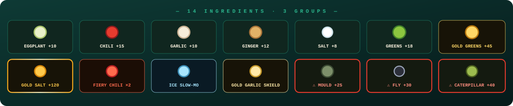

## 🌐 Sprachen wechseln

Lọ Chéo bringt **7 Oberflächensprachen** mit — sofort wirksam, ohne Neuladen, ohne laufende Runde zu verlieren:


| Sprache | Wo | Gespeichert in |
| --- | --- | --- |
| 🇻🇳 Tiếng Việt | **VI**-Taste (Standard; sonst Browser-Sprache) | `locheo.lang.v1` |
| 🇬🇧 English | **EN** Taste | `locheo.lang.v1` |
| 🇨🇳 中文 | **中** Taste | `locheo.lang.v1` |
| 🇯🇵 日本語 | **日** Taste | `locheo.lang.v1` |
| 🇰🇷 한국어 | **한** Taste | `locheo.lang.v1` |
| 🇪🇸 Español | **ES** Taste | `locheo.lang.v1` |
| 🇫🇷 Français | **FR** Taste | `locheo.lang.v1` |

- Sprachwechsel unter **Einstellungen → SPRACHE** (Raster mit 7 Flaggen-Buttons) — nur ein Ort, kein schwebender Umschalter mehr über dem Menü.
- Jeder sichtbare String lebt in `src/i18n/locales/{vi,en,zh,ja,ko,es,fr}.ts` — Canvas-Engine, Screens, HUD, Popups, Ticker, Hinweise.
- Schlüssel fehlt? `t()` fällt auf Vietnamesisch zurück — die sieben Key-Sets (inkl. Placeholder) werden per Test erzwungen.

## 🕹️ Steuerung

| Aktion | Tastatur | Touch |
| --- | --- | --- |
| Bewegen | `W` `A` `S` `D` oder `← ↑ ↓ →` | Überall ziehen (schwebender Joystick) |
| **Schiefe (CHÉO)** | **2 Tasten gleichzeitig** halten (z. B. `A`+`W`) | Mit **45°** ziehen — Joystick-Ring wird golden |
| Glas-Slam (Schockwelle + Vakuum) | `Space` | Roter **SLAM**-Button unten rechts |
| Pause / Fortsetzen | `P` oder `Esc` | Pause-Button oben rechts |
| Sofortiger Neustart | `R` (auch in Pause/Game-Over) | „Noch ein Pickle“-Button |
| Start / Bestätigen | `Enter` | **BETRETEN DIE KÜCHE**-Button |
| Stumm / Ton an | `M` | Lautsprecher-Button oben rechts |
| Sprache wechseln | — (VI/EN/中/日/한/ES/FR-Buttons) | VI/EN/中/日/한/ES/FR-Buttons im Menü / Pause |

## 🚀 Installieren & Starten

### Sofort spielen (ohne Build)

```bash
# Jeder Release liefert eine einzige in sich geschlossene Datei:
open dist/index.html      # macOS
xdg-open dist/index.html  # Linux
start dist/index.html     # Windows
```

### Produktions-Build

```bash
npm install        # Abhängigkeiten installieren (Node ≥ 20.19)
npm run build      # → dist/index.html (eine in sich geschlossene Datei)
```

> `vite-plugin-singlefile` inlined sämtliches JS/CSS/Fonts/Bilder in **eine** `dist/index.html` (~700 KB, gzip ~355 KB). Kein Server, kein Netz.

### Entwicklung

```bash
npm run dev        # Dev-Server mit HMR (http://localhost:5173)
npm run preview    # Produktions-Build lokal ausliefern
npm run typecheck  # tsc --noEmit (strict, noUnusedLocals…)
npm run test       # vitest — 520 Unit-Tests (modes / achievements / storage / i18n / settings)
npm run check      # typecheck + test + build (CI-Qualitätstor)
```

## 🗂️ Projektstruktur

```
lo-cheoio/
├─ index.html              # Einstieg, SEO/OG-Meta (kein CDN)
├─ package.json            # lo-cheoio v1.1.8, dev/build/test/check-Skripte
├─ .gitattributes          # *.bat/*.cmd → CRLF · posix → LF · binaries
├─ vite.config.ts          # vite + react + tailwind v4 + singlefile
├─ tsconfig.json           # strict; enthält src + tests
├─ favicon.ico             # web icon (multi-size 16→256)
├─ public/                 # favicon.ico/png/svg served at web root
├─ assets/
│  ├─ banner.svg           # README-Banner (SMIL-Animation)
│  ├─ demo.svg             # Gameplay-Simulation (SMIL-Animation)
│  ├─ items.svg            # die 14 Zutaten (SMIL-Animation)
│  ├─ modes.svg            # die 9 Modi (SMIL-Animation)
│  ├─ languages.svg        # 7 in-game languages (SMIL animation)
│  ├─ new-modes.svg        # the 2 new v1.1.4 modes (SMIL animation)
│  ├─ corner-menu.svg     # corner GAME/INFO panels (SMIL animation)
│  ├─ settings-sections.svg # 6-section settings tour (SMIL, v1.1.6)
│  ├─ divider.svg          # sparkle divider (SMIL animation)
│  ├─ license.svg          # animiertes AGPL-3.0-Copyleft-Siegel (SMIL-Animation)
│  └─ favicon.svg          # favicon (SMIL animation)
├─ scripts/
│  ├─ play-mac.command     # macOS-Launcher — Doppelklick, farbiges Menü
│  ├─ play-windows.bat     # Windows-Launcher — Doppelklick, farbiges Menü
│  ├─ play-linux.sh        # Linux-Launcher — Doppelklick, farbiges Menü
│  └─ README.md            # Launcher-Anleitung für Terminal-Neulinge
├─ docs/
│  ├─ README.md            # Doku-Index (v1.1.5)
│  ├─ DESCRIPTION.md       # mehrsprachige Projektbeschreibungen (vi/en/zh + SEO)
│  ├─ design/              # menu-corners / save-format / settings-format Specs
│  ├─ guides/              # Engine-Überblick · a11y · Performance · storage keys · Release-Playbook…
│  └─ releases/
│     ├─ v1.0.0.md         # erste Release-Notes
│     ├─ v1.1.0.md         # v1.1.0 Release-Notes
│     ├─ v1.1.1.md         # v1.1.1 Release-Notes
│     ├─ v1.1.2.md         # v1.1.2
│     ├─ v1.1.3.md         # v1.1.3 release notes
│     ├─ v1.1.4.md         # release notes (1.1.4)
│     ├─ v1.1.5.md         # release notes (1.1.5)
│     ├─ v1.1.6.md         # release notes (1.1.6)
│     └─ v1.1.8.md         # current release notes (1.1.8)
├─ README.md               # 🇻🇳 Tiếng Việt
├─ README.en.md            # 🇬🇧 English
├─ README.zh.md            # 🇨🇳 中文
├─ README.ja.md            # 🇯🇵 日本語
├─ README.ko.md            # 🇰🇷 한국어
├─ README.es.md            # 🇪🇸 Español
├─ README.fr.md            # 🇫🇷 Français
├─ README.th.md            # 🇹🇭 ไทย
├─ README.de.md            # 🇩🇪 Deutsch (diese Datei)
├─ README.pt.md            # 🇵🇹 Português
├─ src/
│  ├─ main.tsx             # React-Wurzel, StrictMode
│  ├─ App.tsx              # Phasenmaschine menu/playing/paused/gameover
│  ├─ version.ts           # APP_VERSION = "1.1.8" (einzige Wahrheitsquelle)
│  ├─ index.css            # tailwind v4-Theme + alle Animationen/Verläufe
│  ├─ assets/fonts/        # woff2-Subsets (Be Vietnam Pro ×6, Bungee)
│  ├─ styles/fonts.css     # @font-face + unicode-range, 100% offline
│  ├─ i18n/
│  │  ├─ i18n.ts           # reines Modul: detect, persist, t() + Interpolation
│  │  ├─ useI18n.ts        # React-Hook: useI18n/useLanguage
│  │  └─ locales/          # vi.ts (Key-Quelle) · en · zh · ja · ko · es · fr
│  ├─ components/
│  │  ├─ GameCanvas.tsx    # Canvas + schwebender Joystick + Tastatur + Visibility
│  │  ├─ StartScreen.tsx   # Menü: Hero + mehrschichtige Szene + Eck-Panels
│  │  ├─ menu/              # Eck-Panels GAME/INFO + Modals + icons/
│  │  │  └─ background/     # 8 background layers as data (v1.1.8)
│  │  ├─ ModeSelector.tsx  # 9 Modus-Karten (classic/zen/inferno/blitz/goldrush/storm/hardcore · combo · feast)
│  │  ├─ AchievementsPanel.tsx  # gesperrtes/freigeschaltetes Badge-Tableau
│  │  ├─ GameOverScreen.tsx     # GLAS ZERBROCHEN! + Punkte + neue Erfolge
│  │  ├─ PauseScreen.tsx        # PAUSIERT + Run-Statistiken
│  │  ├─ settings/           # Einstellungen in 6 Abschnitten + Controls (v1.1.6)
│  │  └─ ui/               # acht Primitives, je eine Datei (v1.1.8 — aus ui.tsx herausgelöst)
│  ├─ game/
│  │  ├─ engine.ts         # gesamte Simulation + Canvas-Rendering (~2260 Zeilen)
│  │  ├─ modeTypes.ts      # ModeId · ModeConfig (types-only, v1.1.8)
│  │  ├─ modes/            # 9 balance records — classic.ts … feast.ts (v1.1.8)
│  │  ├─ modesIndex.ts     # MODES · MODE_LIST · isModeId (v1.1.8)
│  │  ├─ modeMath.ts       # multiplierForCombo · jarBonus · comboWindowFor… (v1.1.8)
│  │  ├─ modes.ts          # barrel — keeps every old import working
│  │  ├─ achievements.ts   # 16 Badges + pure Prüfung (pure)
│  │  ├─ storage.ts        # localStorage: TOP 8, Fortschritt, Erfolge
│  │  ├─ audio.ts          # Web Audio Synth: SFX + pentatonische Musik
│  │  ├─ changelog/          # in-game changelog (v1.1.8 — split from one file)
│  │  │  ├─ types.ts        #   ChangelogEntry · ReleaseTier · copyFor()
│  │  │  ├─ tiers.ts        #   tierFor() · TIER_ORDER · TIER_LABEL_KEY
│  │  │  ├─ entries/        #   1 file per release — v1_0_0.ts … v1_1_7.ts
│  │  │  └─ index.ts        #   ordered list + 5 helpers
│  │  ├─ runSave.ts         # Persistenz pausierter Runs
│  │  ├─ settings.ts        # Settings-Schema, Defaults, Normalisierung
│  │  ├─ settingsIO.ts      # Backup-/Restore-Codec (v1.1.6)
│  │  ├─ settingsPresets.ts # vier Schnell-Presets (v1.1.6)
│  │  └─ audioLevels.ts     # reine Gain-Mathematik (v1.1.6)
│  └─ utils/
│     ├─ cn.ts             # clsx + tailwind-merge
│     └─ useFocusTrap.ts   # Fokus im Modal halten (v1.1.6)
└─ tests/                  # vitest — 51 Dateien · 520 Tests (modes · achievements · storage · i18n · runSave · settings · presets · audio…)
```

## 🧱 Architektur & Performance
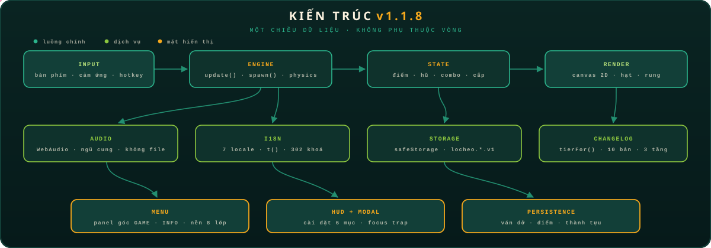


- **Spielschleife** auf `requestAnimationFrame` mit Delta-Time, geklemmt auf `1/20s`, multipliziert mit `timeScale` (Eis-Zeitlupe) und einem kurzen **Hit-Stop**-Einfrieren bei jedem Fang für das „Wucht"-Gefühl.
- **Canvas-HUD** wird jeden Frame direkt gezeichnet; React rendert nur Screens je `phase` — kein React-Re-Render im Hot-Loop; bei Sprachwechsel zieht sich das HUD das neue Wörterbuch schon im nächsten Frame.
- **Geschichtete i18n**: `src/i18n/i18n.ts` ist ein reines Modul (kein React), `useI18n` überbrückt nur das Re-Rendering über das `locheo:languagechange`-Event; `t()` unterstützt `{param}`-Interpolation und fällt auf Vietnamesisch zurück.
- **Fliesenboden** wird einmalig in ein Offscreen-Canvas vorgerendert (inkl. Vignette + Lichtpools); Sternfunkeln und Blasen werden in Echtzeit berechnet — sehr günstig.
- **Budget**: ≤460 Partikel, ≤70 Items, ≤34 Popups, DPR ≤ 2; Hitbox-Kollision sweep; Gurken-Splats am Boden räumen sich selbst auf.
- **localStorage** mit Eingabevalidierung/Normalisierung — ein Datensatzfehler korrumpiert nie die Bestenliste; ist der Speicher gesperrt (Safari Privatmodus), spielt das Spiel im Speicher weiter; die Sprachwahl lebt separat in `locheo.lang.v1`.
- **Motion chill**: `prefers-reduced-motion` deaktiviert Aurora/Shimmer/Rotation; sowohl die Hintergrundsterne als auch die Bildschirm-Erschütterung respektieren die Media Queries.

## ❓ FAQ

**Der Windows-Launcher meckert über vietnamesische Zeichen?**
In v1.1.4 behoben: `play-windows.bat` ist jetzt CRLF + UTF-8 BOM mit `chcp 65001` und vietnamesischen Diakritika vollständig erhalten — der Fehler `'Ọ' is not recognized...` ist Geschichte. Wenn du die .bat mit anderem Editor bearbeitest, CRLF & BOM beibehalten (`.gitattributes` erzwingt das automatisch).


**Kann ich ohne Netzwerk spielen?**
Ja — zu 100%: öffne `dist/index.html` und alles funktioniert, inklusive Fonts und Audio. Es gibt keinen einzigen Netzwerkaufruf.

**Werbung oder Telemetrie?**
Keine. Kein Tracking, keine Analyse — deine Punkte verlassen nie dein localStorage.

**Geht beim Sprachwechsel mein Fortschritt verloren?**
Nein. Punkte, Erfolge, Fortschritt und Modusauswahl sind alle unabhängig von `locheo.lang.v1`.

**Wo werden die TOP-8-Punkte gespeichert?**
`locheo.scores.v1` (Punkte), `locheo.progress.v1` (Gesamt-Runs/Gläser/Zerstörungen), `locheo.achievements.v1` (Badges) — wer den Speicher löscht, verliert auch sie — also hüte das Glas!

**Willst du eine weitere Sprache hinzufügen?**
Füge `src/i18n/locales/xx.ts` hinzu, spiegele das `vi.ts`-Key-Set, aktualisiere `LANGUAGES` + Tests und öffne einen PR — siehe [CONTRIBUTING.md](CONTRIBUTING.md).

**Kein Terminal-Mensch?**
Doppelklick auf [`scripts/play-mac.command`](scripts/play-mac.command) (macOS), [`scripts/play-windows.bat`](scripts/play-windows.bat) (Windows) oder [`scripts/play-linux.sh`](scripts/play-linux.sh) (Linux) — ein farbiges Menü erscheint; wähle `1` für Build & sofortiges Spielen, `2` für den Dev-Server. Details: [scripts/README.md](scripts/README.md).

## 📦 Releases & Änderungsprotokoll

| Version | Tier | Datum | Notizen |
| --- | --- | --- | --- |
| [v1.1.8](docs/releases/v1.1.8.md) | 🟣 **PATCH** | 2026-11-12 | **Der Startbildschirm läuft nicht mehr über**: eine verpatzte Höhen-Addition ließ dem Hero nur 250px und schnitt `LỌ` ab · **Scroll-Fehler** (verschachtelte Scroll-Box + `justify-center`) mit **einem** oben verankerten `.menu-scroll` behoben · **«Spielanleitung» ins GAME-Menü** als Modal · Panels mit **318px/458px** deklariert statt nach Inhalt · 48px-Ticker · **14 Hero-Dekorationen** + **3 Halo-Ringe** · `src/components/menu/{layout,scene,ticker,howto}/` · **520 Tests / 51 Dateien** |
| [v1.1.7](docs/releases/v1.1.7.md) | 🟣 **PATCH** | 2026-11-10 | **Menü-Hintergrund entnebelt** (vier Ebenen: `blur 64→22px`, Ecken-Vignette statt Vollbild, CRT-Rahmen 140→90px, Boden 45→70%) · **farbige Changelog-Stufen** · **96 neue Stichpunkte** für 8 Versionen · Daten neu geordnet · `src/game/changelog/` aufgeteilt · 10 READMEs neu · **256 Tests** |
| [v1.1.6](docs/releases/v1.1.6.md) | 🟣 **PATCH** | 2026-11-08 | **Einstellungen in 6 Abschnitten** (Presets · Audio · Anzeige · Sprache · Backup · Daten) · Lautstärken 0–100 · Shake-Stärke · Bildqualität · Auto-Pause beim Tab-Wechsel · Sprache in den Einstellungen · 4 Presets · JSON-Export/Import · mehrschichtige Menüszene · Verlauf auf der Autorenkarte · Fokus in Modals gefangen · Musik-nach-Reload-Fix · **150 Tests** |
| [v1.1.5](docs/releases/v1.1.5.md) | 🟣 **PATCH** | 2026-11-06 | **Eck-Panels GAME/INFO** (Spielen · Fortsetzen · Modi · Rangliste · Erfolge · Einstellungen / Über den Autor · Changelog · Beenden) · **Speichern & Fortsetzen** (`locheo.run.v1`) · In-game-Einstellungen (SFX/Musik/Shake/Reduced Motion) · Modal-Shortcut-Leck gefixt · prefers-reduced-motion überall · **113 Tests** |
| [v1.1.4](docs/releases/v1.1.4.md) | 🟣 **PATCH** | 2026-11-04 | **9 Modi** (Combo-Festival · Großes Gelage) · **16 Erfolge** · **7 Sprachen** (ES/FR neu) · play-windows.bat Fix (CRLF+BOM) · Launcher in 7 Sprachen · 61 Tests |
| [v1.1.3](docs/releases/v1.1.3.md) | 🟣 **PATCH** | 2026-11-02 | 7 Modi (Eingelegter Regen · Dünnes Keramik) · 14 Erfolge · 5 Sprachen · Favicon · mehrsprachige Launcher · 55 Tests |
| [v1.1.2](docs/releases/v1.1.2.md) | 🟣 **PATCH** | 2026-10-31 | 5 Modi (60-Sekunden-Rush · Goldrausch) · 12 Erfolge · Combo-Flammen · Doppelklick-Launcher · README in 10 Sprachen · 49 Tests |
| [v1.1.1](docs/releases/v1.1.1.md) | 🟣 **PATCH** | 2026-10-29 | In-game i18n VI/EN/ZH · README in 7 Sprachen · komplette Bug-Ausmerzung · 45 Tests |
| [v1.1.0](docs/releases/v1.1.0.md) | 🟡 **UPDATE** | 2026-10-27 | 3 Spielmodi · Goldknoblauch-Schild · Raupe · Goldgemüse · 10 Erfolge · selbst gehostete Fonts |
| [v1.0.0](docs/releases/v1.0.0.md) | 🩷 **MAJOR** | 2026-10-24 | Erste Veröffentlichung: komplette Engine, 11 Zutaten, JAR SLAM, ×9 Combo |

Siehe auch [CHANGELOG.md](CHANGELOG.md).

## 🗺️ Roadmap (Entwurf — ändert sich mit Feedback)

| Meilenstein | ETA | Ideen |
| --- | --- | --- |
| **v1.2.0** | 2026 Q1 | Prozeduraler Soundtrack pro Modus · visuelle Regressionstests (Playwright) in der CI · tieferes Font-Subsetting zum Schrumpfen des Bundles |
| **v1.3.0** | 2026 Q1–Q2 | 10. Spielmodus (Kandidat: **FLIEGENSTURM** — nur Fliegen, nur durch Schlagen überleben) · Seed-Modus für Daily Challenges |
| **v1.4.0** | 2026 Q2 | **Opt-in**-Online-Rangliste (serverless, verschlüsselt) — Offline-first bleibt der Standard |
| Backlog | — | Ghost-Replay deines besten Laufs · Fotomodus (HUD ausblenden, PNG exportieren) · Thai (ไทย)-Locale in Prüfung |

*Eine Roadmap ist kein Versprechen — Priorität ist immer: Stabilität → einfacher zu spielen → mehr Inhalt.*

## 📚 Weiterführende Doku & Dev-Notes

Design-Notizen und tiefergehende technische Doku:

| Doc | What it covers |
| --- | --- |
| [docs/releases/v1.1.8.md](docs/releases/v1.1.8.md) | Release v1.1.8 — vier Layout-Fehler aus einer einzigen Höhen-Addition, der verschachtelte Scroll-Fehler, «Spielanleitung» im GAME-Menü, 14 Hero-Dekorationen |
| [docs/releases/v1.1.7.md](docs/releases/v1.1.7.md) | Release v1.1.7 — Menü-Hintergrund entnebelt (Vier-Ebenen-Diagnose), Changelog in Stufen, 96 neue Stichpunkte |
| [docs/releases/v1.1.6.md](docs/releases/v1.1.6.md) | Release v1.1.6 — Einstellungen in 6 Abschnitten, Presets, Backup, mehrschichtiges Menü |
| [docs/releases/v1.1.5.md](docs/releases/v1.1.5.md) | Release v1.1.5 — Eck-Menüs, Speichern/Fortsetzen, Einstellungen, Fixes |
| [docs/design/menu-corners.md](docs/design/menu-corners.md) | Design des Eck-Menüs GAME/INFO — Prinzipien, a11y, Responsive |
| [docs/design/save-format.md](docs/design/save-format.md) | Spec `locheo.run.v1` — Snapshot eines unterbrochenen Laufs (Schema + Lebenszyklus) |
| [docs/design/settings-format.md](docs/design/settings-format.md) | Spec `locheo.settings.v1` — Spieleinstellungen (Schema + Wiring) |
| [docs/guides/troubleshooting.md](docs/guides/troubleshooting.md) | Häufige Probleme — schwarzer Bildschirm · Audio · Fortsetzen · Launcher |
| [scripts/smoke-ssr.tsx](scripts/smoke-ssr.tsx) | Headless-Render-Smoke-Test (kompletter Menü-/Modal-Baum) |
| [.github/workflows/ci.yml](.github/workflows/ci.yml) | CI: npm ci → npm run check (Node 22) |

## 🤝 Mitwirken

1. Forke das Repo, Branch nach dem Schema `arena/<name>` oder `feat/<name>`.
2. `npm run check` muss grün sein, bevor du einen PR öffnest (typecheck + 520 Tests + build).
3. Vermeide neue Laufzeit-Abhängigkeiten, sofern nicht unbedingt nötig — Philosophie: **eine Datei, kein Netz, ewig spielbar**.
4. Nenne in deinem PR die betroffenen Screens/Modi und hänge bei Gameplay-Änderungen einen Clip an.

## 📄 Lizenz & Autor

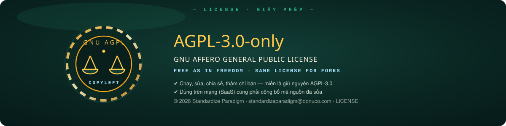

- **AGPL-3.0-only** © 2026 [Standardize Paradigm](mailto:standardizeparadigm@donuco.com) — siehe [LICENSE](LICENSE) & [assets/license.svg](assets/license.svg).
- Fonts: [Be Vietnam Pro](https://fonts.google.com/specimen/Be+Vietnam+Pro) & [Bungee](https://fonts.google.com/specimen/Bungee) — SIL Open Font License 1.1 (selbst gehostete woff2-Subsets).
- An jedes Picklglas auf jedem vietnamesischen Reistablett — auf euch. 🫙🇻🇳
