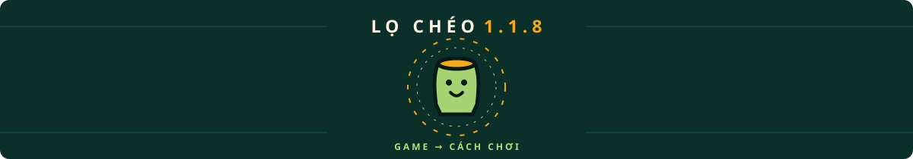

<div align="center">


# LỌ CHÉO — LA GRAN GUERRA DE LA ORZA

### 🫙 Arcade vietnamita de encurtidos que corre 100% en el navegador — un único HTML, offline-first
### 🌐 UI del juego en 7 idiomas — Tiếng Việt · English · 中文 · 日本語 · 한국어 · Español · Français

[🇻🇳 Tiếng Việt](README.md) · [🇬🇧 English](README.en.md) · [🇨🇳 中文](README.zh.md) · [🇯🇵 日本語](README.ja.md) · [🇰🇷 한국어](README.ko.md) · [🇪🇸 Español](README.es.md) · [🇫🇷 Français](README.fr.md) · [🇹🇭 ไทย](README.th.md) · [🇩🇪 Deutsch](README.de.md) · [🇵🇹 Português](README.pt.md)

[](docs/releases/v1.1.8.md)
[](docs/releases/v1.1.8.md)
[](tests/README.md)
[](https://github.com/standardizeparadigm/Lo-CheoIO/actions/workflows/ci.yml)
[](LICENSE)
[](#-instalación-y-ejecución)
[](#-build-de-producción)
[](#-cambiar-de-idioma)
[](CONTRIBUTING.md)


</div>

---

## 🥒 Sobre el proyecto

> Lọ Chéo — La Gran Guerra de la Orza: un arcade de encurtidos que corre 100% en el navegador, empaquetado en un único archivo HTML autocontenido, offline-first — sin CDN, sin servidor. La orza de cerámica solo sabe moverse en **diagonal**: mantén dos teclas para zigzaguear, acelerar y despedazar moho, moscas y orugas; llena la orza antes de que la cerámica se raje en tres. **9 modos · 14 ingredientes · 16 logros · ranking TOP 8 · UI en 7 idiomas.**

Es un **arcade de acción de pantalla única** inspirado en los humildes encurtidos vietnamitas. Sin niveles lineales ni menús recargados: solo la orza, una lluvia infinita de verduras y tus reflejos en llamas.


## 🆕 Novedades de v1.1.8

> El último parche antes de 1.2.0 centra el título LỌ CHÉO y sitúa la orza y sus órbitas debajo. Las instrucciones de teclado y táctiles pasan a **GAME → Cómo jugar**. Se conservan los menús y el progreso; también se actualizan las herramientas por seguridad.



[📋 v1.1.8](docs/releases/v1.1.8.md) · [📜 CHANGELOG](CHANGELOG.md) · [🧭 Menu hero](docs/design/menu-hero.md)


## ✨ Lo destacado

| Grupo | Detalles |
| --- | --- |
| 🎮 **9 modos de juego** | **ENCURTIDO CLÁSICO** (equilibrado) · **ZEN** (sin peligros, ×0.5) · **INFIERNO DE CHILE** (+35% velocidad, ×1.5) · **60 SEGUNDOS** (contrarreloj 60 s, ×1.25) · **FIEBRE DE ORO** (botín dorado ×2.6) · **LLUVIA DE CONSERVAS** (densidad ~1.4×, ×0.75) · **CERÁMICA FINA** (una grieta es fatal, ×2.0) · **FESTIVAL DE COMBOS** (ventana ×2, ×1.15) · **GRAN FESTÍN** (densidad ~×2, tarro ×2.5, ×0.6) |
| 🌐 **i18n en el juego** | Tiếng Việt · English · 中文 · 日本語 · 한국어 · Español · Français — `src/i18n/` (módulo puro + puente React), `t()` con interpolación, sincroniza `<html lang>`, números por locale (vi-VN / en-US / zh-CN / ja-JP / ko-KR / es-ES / fr-FR) |
| 🕹️ **Mecánica AL CORTE exclusiva** | Mantén 2 teclas/ejes en diagonal — la orza acelera, brilla y despedaza peligros. Barra de stamina dedicada con histéresis anti-parpadeo |
| 🥬 **14 ingredientes** | Berenjena, chile, ajo, jengibre, sal, mostaza, **MOSTAZA DORADA** (llena la orza rápido) · SAL/AJO DORADO · CHILE INFERNAL · HIELO · MOHO, MOSCA, **ORUGA** (peligros) |
| 🧄 **Escudo de Ajo Dorado** | Mejora: apila hasta **2 cargas** que absorben las grietas; un halo giratorio orbita la orza |
| 🏆 **16 logros** | Guardados **entre partidas** (localStorage), con aviso «¡NUEVO LOGRO!» en la pantalla de fin |
| 🔊 **Audio artesanal** | 11 efectos sintetizados con Web Audio API (cero archivos) + pentatónica que modula con el nivel; silencio con `M` |
| 💾 **Clasificación TOP 8** | Guardado local, validado y normalizado al leer, nombres en mayúsculas automáticas, highlight para el récord recién marcado |
| 🎨 **Gráficos 60fps** | Canvas 2D, presupuesto de 460 partículas, DPR tope 2, suelo de losetas pre-renderizado offscreen, titileo de estrellas + aurora en el menú |
| 📴 **Offline-first de verdad** | Fuentes auto-alojadas (subsets latin + vietnamita, woff2), sin CDN ni APIs — abre `dist/index.html` y a jugar |
| 🧪 **Calidad** | 262 tests unitarios (vitest) para modes / achievements / storage / i18n / settings — `npm run check` es la puerta de CI |


## 🌐 Cambiar de idioma

Lọ Chéo incluye **7 idiomas de interfaz**, aplicados al instante — sin recargar, sin perder la partida:


| Idioma | Dónde | Guardado en |
| --- | --- | --- |
| 🇻🇳 Tiếng Việt | botón **VI** (predeterminado; sigue el idioma del navegador) | `locheo.lang.v1` |
| 🇬🇧 English | **EN** botón | `locheo.lang.v1` |
| 🇨🇳 中文 | **中** botón | `locheo.lang.v1` |
| 🇯🇵 日本語 | **日** botón | `locheo.lang.v1` |
| 🇰🇷 한국어 | **한** botón | `locheo.lang.v1` |
| 🇪🇸 Español | **ES** botón | `locheo.lang.v1` |
| 🇫🇷 Français | **FR** botón | `locheo.lang.v1` |

- Cambia el idioma en **Ajustes → IDIOMA** (rejilla de 7 botones con bandera) — un único lugar, sin selector flotante sobre el menú.
- Todas las cadenas visibles viven en `src/i18n/locales/{vi,en,zh,ja,ko,es,fr}.ts` — motor canvas, pantallas, HUD, popups, ticker, pistas.
- ¿Falta una clave? `t()` cae al vietnamita — los siete juegos de claves (y sus placeholders) los garantizan los tests.

## 🕹️ Controles

| Acción | Teclado | Táctil |
| --- | --- | --- |
| Mover | `W` `A` `S` `D` o `← ↑ ↓ →` | Arrastra en cualquier parte (joystick flotante) |
| **Corte diagonal (CHÉO)** | Mantén **2 teclas a la vez** (p. ej. `A`+`W`) | Arrastra en **45°** — el anillo del joystick se vuelve dorado |
| Golpe de orza (onda + aspiradora) | `Space` | Botón rojo **SLAM**, abajo a la derecha |
| Pausa / continuar | `P` o `Esc` | Botón de pausa, arriba a la derecha |
| Reinicio instantáneo | `R` (también en pausa/game over) | Botón «Otra tanda» |
| Empezar / confirmar | `Enter` | Botón **AL FUEGO** |
| Silencio / sonido | `M` | Botón de altavoz, arriba a la derecha |
| Cambiar idioma | — (usa los botones VI/EN/中/日/한/ES/FR) | Botones VI/EN/中/日/한/ES/FR en menú / pausa |

## 🚀 Instalación y ejecución

### Juega ya (sin build)

```bash
# cada release incluye un único archivo autocontenido:
open dist/index.html      # macOS
xdg-open dist/index.html  # Linux
start dist/index.html     # Windows
```

### Build de producción

```bash
npm install        # instala dependencias (Node ≥ 20.19)
npm run build      # → dist/index.html (un único archivo autocontenido)
```

> `vite-plugin-singlefile` incrusta todo el JS/CSS/fuentes/imágenes en **un** `dist/index.html` (~700 KB, gzip ~355 KB). Sin servidor, sin red.

### Desarrollo

```bash
npm run dev        # servidor de desarrollo con HMR (http://localhost:5173)
npm run preview    # sirve el build de producción localmente
npm run typecheck  # tsc --noEmit (strict, noUnusedLocals…)
npm run test       # vitest — 262 tests unitarios (modes / achievements / storage / i18n / settings)
npm run check      # typecheck + test + build (puerta de calidad CI)
```

## 🗂️ Estructura del proyecto

```
lo-cheoio/
├─ index.html              # entrada, meta SEO/OG (sin CDN)
├─ package.json            # lo-cheoio v1.1.8, scripts dev/build/test/check
├─ .gitattributes          # *.bat/*.cmd → CRLF · posix → LF · binaries
├─ vite.config.ts          # vite + react + tailwind v4 + singlefile
├─ tsconfig.json           # strict; incluye src + tests
├─ favicon.ico             # web icon (multi-size 16→256)
├─ public/                 # favicon.ico/png/svg served at web root
├─ assets/
│  ├─ banner.svg           # banner del README (animación SMIL)
│  ├─ demo.svg             # simulación de gameplay (animación SMIL)
│  ├─ items.svg            # los 14 ingredientes (animación SMIL)
│  ├─ modes.svg            # los 9 modos (animación SMIL)
│  ├─ languages.svg        # 7 in-game languages (SMIL animation)
│  ├─ new-modes.svg        # the 2 new v1.1.4 modes (SMIL animation)
│  ├─ corner-menu.svg     # corner GAME/INFO panels (SMIL animation)
│  ├─ settings-sections.svg # 6-section settings tour (SMIL, v1.1.6)
│  ├─ divider.svg          # sparkle divider (SMIL animation)
│  ├─ license.svg          # sello copyleft AGPL-3.0 animado (animación SMIL)
│  └─ favicon.svg          # favicon (SMIL animation)
├─ scripts/
│  ├─ play-mac.command     # lanzador macOS — doble clic, menú a todo color
│  ├─ play-windows.bat     # lanzador Windows — doble clic, menú a todo color
│  ├─ play-linux.sh        # lanzador Linux — doble clic, menú a todo color
│  └─ README.md            # guía de lanzadores para novatos de la terminal
├─ docs/
│  ├─ README.md            # índice de documentación (v1.1.5)
│  ├─ DESCRIPTION.md       # descripciones multilingüe (vi/en/zh + SEO)
│  ├─ design/              # specs menu-corners / save-format / settings-format
│  ├─ guides/              # overview del engine · a11y · rendimiento · storage keys · release playbook…
│  └─ releases/
│     ├─ v1.0.0.md         # notas del primer release
│     ├─ v1.1.0.md         # notas de v1.1.0
│     ├─ v1.1.1.md         # notas de v1.1.1
│     ├─ v1.1.2.md         # v1.1.2
│     ├─ v1.1.3.md         # v1.1.3 release notes
│     ├─ v1.1.4.md         # release notes (1.1.4)
│     ├─ v1.1.5.md         # release notes (1.1.5)
│     ├─ v1.1.6.md         # release notes (1.1.6)
│     └─ v1.1.8.md         # current release notes (1.1.8)
├─ README.md               # 🇻🇳 Tiếng Việt
├─ README.en.md            # 🇬🇧 English
├─ README.zh.md            # 🇨🇳 中文
├─ README.ja.md            # 🇯🇵 日本語
├─ README.ko.md            # 🇰🇷 한국어
├─ README.es.md            # 🇪🇸 Español (este archivo)
├─ README.fr.md            # 🇫🇷 Français
├─ README.th.md            # 🇹🇭 ไทย
├─ README.de.md            # 🇩🇪 Deutsch
├─ README.pt.md            # 🇵🇹 Português
├─ src/
│  ├─ main.tsx             # raíz React, StrictMode
│  ├─ App.tsx              # máquina de fases menu/playing/paused/gameover
│  ├─ version.ts           # APP_VERSION = "1.1.8" (fuente única de verdad)
│  ├─ index.css            # tema tailwind v4 + todas las animaciones/gradientes
│  ├─ assets/fonts/        # subsets woff2 (Be Vietnam Pro ×6, Bungee)
│  ├─ styles/fonts.css     # @font-face + unicode-range, 100% offline
│  ├─ i18n/
│  │  ├─ i18n.ts           # módulo puro: detección, persistencia, t() + interpolación
│  │  ├─ useI18n.ts        # hook React: useI18n/useLanguage
│  │  └─ locales/          # vi.ts (fuente de claves) · en · zh · ja · ko · es · fr
│  ├─ components/
│  │  ├─ GameCanvas.tsx    # canvas + joystick flotante + teclado + visibilidad
│  │  ├─ StartScreen.tsx   # menú: hero + escena en capas + paneles de esquina
│  │  ├─ menu/              # paneles GAME/INFO + modales + icons/
│  │  │  ├─ hero/          # centered menu wordmark + mascot (v1.1.8)
│  │  │  ├─ HowToPlayModal.tsx # GAME → instructions
│  │  │  └─ background/     # 8 background layers as data (v1.1.7)
│  │  ├─ ModeSelector.tsx  # 9 tarjetas de modo (classic/zen/inferno/blitz/goldrush/storm/hardcore · combo · feast)
│  │  ├─ AchievementsPanel.tsx  # muro de insignias bloqueadas/desbloqueadas
│  │  ├─ GameOverScreen.tsx     # ¡ORZA ROTA! + puntos + nuevos logros
│  │  ├─ PauseScreen.tsx        # PAUSA + estadísticas de la partida
│  │  ├─ settings/           # ajustes en 6 secciones + controles (v1.1.6)
│  │  └─ ui/               # ocho primitivas, un archivo cada una (v1.1.7 — separadas de ui.tsx)
│  ├─ game/
│  │  ├─ engine.ts         # toda la simulación + render canvas (~2260 líneas)
│  │  ├─ modeTypes.ts      # ModeId · ModeConfig (types-only, v1.1.7)
│  │  ├─ modes/            # 9 balance records — classic.ts … feast.ts (v1.1.7)
│  │  ├─ modesIndex.ts     # MODES · MODE_LIST · isModeId (v1.1.7)
│  │  ├─ modeMath.ts       # multiplierForCombo · jarBonus · comboWindowFor… (v1.1.7)
│  │  ├─ modes.ts          # barrel — keeps every old import working
│  │  ├─ achievements.ts   # 16 insignias + checker puro (puro)
│  │  ├─ storage.ts        # localStorage: top 8, progreso, logros
│  │  ├─ audio.ts          # sintetizador Web Audio: sfx + música pentatónica
│  │  ├─ changelog/          # in-game changelog (v1.1.7 — split from one file)
│  │  │  ├─ types.ts        #   ChangelogEntry · ReleaseTier · copyFor()
│  │  │  ├─ tiers.ts        #   tierFor() · TIER_ORDER · TIER_LABEL_KEY
│  │  │  ├─ entries/        #   1 file per release — v1_0_0.ts … v1_1_7.ts
│  │  │  └─ index.ts        #   ordered list + 5 helpers
│  │  ├─ runSave.ts         # persistencia de partida suspendida
│  │  ├─ settings.ts        # esquema de ajustes, defaults, normalización
│  │  ├─ settingsIO.ts      # códec de copia/restauración (v1.1.6)
│  │  ├─ settingsPresets.ts # cuatro ajustes rápidos (v1.1.6)
│  │  └─ audioLevels.ts     # matemática de ganancia pura (v1.1.6)
│  └─ utils/
│     ├─ cn.ts             # clsx + tailwind-merge
│     └─ useFocusTrap.ts   # foco atrapado en modales (v1.1.6)
└─ tests/                  # vitest — 35 archivos · 262 tests (modes · achievements · storage · i18n · runSave · settings · presets · audio…)
```

## 🧱 Arquitectura y rendimiento


- **Bucle de juego** con `requestAnimationFrame`, delta-time clampeado a `1/20s`, multiplicado por `timeScale` (cámara lenta de HIELO) y un breve **hit-stop** por captura para ese “golpe”.
- **HUD en canvas** dibujado directamente cada frame; React solo renderiza pantallas según `phase` — sin re-renders en el bucle caliente; al cambiar de idioma, el HUD toma el nuevo diccionario en el frame siguiente.
- **i18n por capas**: `src/i18n/i18n.ts` es un módulo puro (sin React), `useI18n` solo puenta los re-renders vía el evento `locheo:languagechange`; `t()` admite interpolación `{param}` y cae al vietnamita.
- **Suelo de losetas** pre-renderizado una vez a un canvas offscreen (con viñeta + charcos de luz); el titileo de estrellas y las pompas se calculan en tiempo real — muy barato.
- **Presupuesto**: ≤460 partículas, ≤70 ítems, ≤34 popups, DPR ≤ 2; colisiones por hitbox; los restos de encurtidos en el suelo se autolimpian.
- **localStorage** con validación/normalización de entrada — un registro corrupto no rompe la tabla; si el almacenamiento está bloqueado (Safari privado) el juego sigue en memoria; el idioma vive aparte en `locheo.lang.v1`.
- **Motion suave**: `prefers-reduced-motion` desactiva aurora/shimmer/spin; las estrellas y el screen shake también respetan las media queries.

## ❓ Preguntas frecuentes

**¿El lanzador de Windows se queja de los caracteres vietnamitas?**
Corregido en v1.1.4: `play-windows.bat` ahora es CRLF + UTF-8 BOM con `chcp 65001` y los diacríticos vietnamitas intactos — el error `'Ọ' is not recognized...` desaparece para siempre. Si editas el .bat con otro editor, conserva CRLF y BOM (`.gitattributes` lo fuerza automáticamente).


**¿Puedo jugar sin red?**
Sí — 100%: abre `dist/index.html` y todo funciona, fuentes y audio incluidos. No hay ni una petición de red.

**¿Hay anuncios o telemetría?**
No. Sin tracking ni analítica — tus puntos solo viven en tu localStorage.

**¿Cambiar de idioma pierde mi progreso?**
No. Puntos, logros, progreso y modo son independientes de `locheo.lang.v1`.

**¿Dónde se guarda el TOP 8?**
`locheo.scores.v1` (puntos), `locheo.progress.v1` (partidas/orzas/despedazadas totales), `locheo.achievements.v1` (insignias) — borrar el almacenamiento los borra, ¡cuida la orza!

**¿Quieres añadir otro idioma?**
Añade `src/i18n/locales/xx.ts` reflejando las claves de `vi.ts`, actualiza `LANGUAGES` + tests y abre un PR — ver [CONTRIBUTING.md](CONTRIBUTING.md).

**¿No te apañas con la terminal?**
Doble clic en [`scripts/play-mac.command`](scripts/play-mac.command) (macOS), [`scripts/play-windows.bat`](scripts/play-windows.bat) (Windows) o [`scripts/play-linux.sh`](scripts/play-linux.sh) (Linux) — aparece un menú a color; elige `1` para compilar y jugar al instante, `2` para el servidor de desarrollo. Detalles: [scripts/README.md](scripts/README.md).

## 📦 Releases y changelog

| Versión | Tier | Fecha | Notas |
| --- | --- | --- | --- |
| [v1.1.8](docs/releases/v1.1.8.md) | 🟣 **PATCH** | 2026-11-13 | El último parche antes de 1.2.0 centra el título LỌ CHÉO y sitúa la orza y sus órbitas debajo. Las instrucciones de teclado y táctiles pasan a **GAME → Cómo jugar**. Se conservan los menús y el progreso; también se actualizan las herramientas por seguridad. |
| [v1.1.7](docs/releases/v1.1.7.md) | 🟣 **PATCH** | 2026-11-13 | **Fondo del menú sin niebla** (cuatro capas: `blur 64→22px`, viñeta de esquinas en vez de pantalla completa, marco CRT 140→90px, suelo 45→70%) · **changelog por niveles con color** · **96 viñetas nuevas** para 8 versiones · `src/game/changelog/` dividido · 10 READMEs rehechos · **256 tests** |
| [v1.1.6](docs/releases/v1.1.6.md) | 🟣 **PATCH** | 2026-11-13 | **Ajustes en 6 secciones** (rápidos · audio · pantalla · idioma · copia · datos) · volúmenes 0–100 · intensidad de sacudida · calidad visual · pausa al cambiar de pestaña · idioma dentro de Ajustes · 4 preajustes · exportar/importar JSON · menú multicapa animado · degradado en la tarjeta del autor · foco atrapado en modales · fix de música al recargar · **150 tests** |
| [v1.1.5](docs/releases/v1.1.5.md) | 🟣 **PATCH** | 2026-11-13 | **Menús de esquina GAME/INFO** (Jugar · Continuar · Modos · Clasificación · Logros · Ajustes / Sobre el autor · Changelog · Salir) · **guardar y reanudar partida** (`locheo.run.v1`) · ajustes in-game (SFX/música/sacudida/movimiento) · fix fuga de atajos por modales · prefers-reduced-motion global · **113 pruebas** |
| [v1.1.4](docs/releases/v1.1.4.md) | 🟣 **PATCH** | 2026-11-12 | **9 modos** (Combo Festival · Gran Festín) · **16 logros** · **7 idiomas** (ES/FR añadidos) · fix play-windows.bat (CRLF+BOM) · lanzadores en 7 idiomas · 61 tests |
| [v1.1.3](docs/releases/v1.1.3.md) | 🟣 **PATCH** | 2026-11-12 | 7 modos (Lluvia de Conservas · Cerámica Fina) · 14 logros · 5 idiomas · favicon · lanzadores multilingües · 55 tests |
| [v1.1.2](docs/releases/v1.1.2.md) | 🟣 **PATCH** | 2026-11-12 | 5 modos (60 Segundos · Fiebre de Oro) · 12 logros · combo en llamas · lanzadores de doble clic · README en 10 idiomas · 49 tests |
| [v1.1.1](docs/releases/v1.1.1.md) | 🟣 **PATCH** | 2026-11-12 | i18n en el juego VI/EN/ZH · README en 7 idiomas · barrido total de bugs · 49 tests |
| [v1.1.0](docs/releases/v1.1.0.md) | 🟡 **UPDATE** | 2026-11-12 | 3 modos · Escudo de Ajo Dorado · Oruga · Mostaza Dorada · 10 logros · fuentes auto-alojadas |
| [v1.0.0](docs/releases/v1.0.0.md) | 🩷 **MAJOR** | 2026-11-12 | Primer release: motor completo, 11 ingredientes, GOLPE DE ORZA, combo ×9 |

Ver también [CHANGELOG.md](CHANGELOG.md).

## 🗺️ Hoja de ruta (borrador — sujeta a cambios según feedback)

| Hito | ETA | Ideas |
| --- | --- | --- |
| **v1.2.0** | TBD | Música procedural por modo · tests de regresión visual (Playwright) en CI · subsetting de fuentes más agresivo para reducir el bundle |
| **v1.3.0** | TBD | 10º modo de juego (candidato: **TORMENTA DE MOSCAS** — solo moscas, sobrevive cortando) · modo con semilla para retos diarios |
| **v1.4.0** | TBD | Tabla de clasificación online **opt-in** (serverless, cifrada) — offline-first sigue siendo el valor por defecto |
| Backlog | — | Ghost replay de tu mejor partida · modo foto (oculta el HUD, exporta PNG) · locale tailandés (ไทย) en evaluación |

*Una hoja de ruta no es una promesa — la prioridad siempre es: estabilidad → que sea más fácil de jugar → más contenido.*

## 📚 Documentación adicional y desarrollo

Notas de diseño y documentación técnica más profunda:

| Doc | What it covers |
| --- | --- |
| [docs/releases/v1.1.6.md](docs/releases/v1.1.6.md) | Release v1.1.6 — ajustes en 6 secciones, preajustes, copia, menú multicapa |
| [docs/releases/v1.1.5.md](docs/releases/v1.1.5.md) | Release v1.1.5 — menús de esquina, guardar/continuar, ajustes, fixes |
| [docs/design/menu-corners.md](docs/design/menu-corners.md) | Diseño del menú de esquina GAME/INFO — principios, a11y, responsive |
| [docs/design/save-format.md](docs/design/save-format.md) | Spec `locheo.run.v1` — snapshot de partida en pausa (schema + ciclo de vida) |
| [docs/design/settings-format.md](docs/design/settings-format.md) | Spec `locheo.settings.v1` — ajustes del juego (schema + wiring) |
| [docs/guides/troubleshooting.md](docs/guides/troubleshooting.md) | Problemas comunes — pantalla negra · audio · Continuar · launcher |
| [scripts/smoke-ssr.tsx](scripts/smoke-ssr.tsx) | Smoke test de render headless (todo el árbol menú/modal) |
| [.github/workflows/ci.yml](.github/workflows/ci.yml) | CI: npm ci → npm run check (Node 22) |

## 🤝 Contribuir

1. Haz fork, crea una rama con la convención `arena/<nombre>` o `feat/<nombre>`.
2. `npm run check` debe estar en verde antes de abrir PR (typecheck + 262 tests + build).
3. Evita nuevas dependencias de runtime salvo necesidad real — filosofía: **un archivo, sin red, jugable para siempre**.
4. En el PR indica las pantallas/modos afectados y adjunta un clip si cambia el gameplay.

## 📄 Licencia y autor


- **AGPL-3.0-only** © 2026 [Standardize Paradigm](mailto:standardizeparadigm@donuco.com) — ver [LICENSE](LICENSE) y [assets/license.svg](assets/license.svg).
- Fuentes: [Be Vietnam Pro](https://fonts.google.com/specimen/Be+Vietnam+Pro) & [Bungee](https://fonts.google.com/specimen/Bungee) — SIL Open Font License 1.1 (subsets woff2 auto-alojados).
- Por cada orza de encurtidos en cada mesa vietnamita — salud. 🫙🇻🇳
