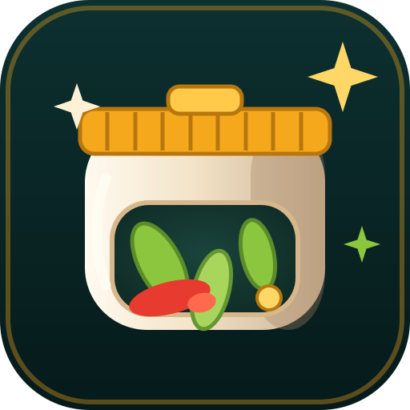

<div align="center">


# LỌ CHÉO — LA GRANDE GUERRE DU BOCAL

### 🫙 L'arcade de pickles vietnamienne qui tourne à 100% dans le navigateur — un seul HTML, offline-first
### 🌐 UI en jeu en 5 langues — Tiếng Việt · English · 中文 · 日本語 · 한국어

[🇻🇳 Tiếng Việt](README.md) · [🇬🇧 English](README.en.md) · [🇨🇳 中文](README.zh.md) · [🇯🇵 日本語](README.ja.md) · [🇰🇷 한국어](README.ko.md) · [🇪🇸 Español](README.es.md) · [🇫🇷 Français](README.fr.md) · [🇹🇭 ไทย](README.th.md) · [🇩🇪 Deutsch](README.de.md) · [🇵🇹 Português](README.pt.md)

[](docs/releases/v1.1.3.md)
[](LICENSE)
[](#-installation--exécution)
[](#-build-de-production)
[](#-changer-de-langue)
[](CONTRIBUTING.md)


</div>

---

## 🥒 À propos du projet

> Lọ Chéo — La Grande Guerre du Bocal : un arcade de pickles qui tourne à 100% dans le navigateur, emballé dans un unique fichier HTML auto-suffisant, offline-first — aucun CDN, aucun serveur. Le bocal en céramique ne sait se déplacer qu'en **diagonale** : maintenez deux touches pour slalomer, accélérer et lacérer moisissures, mouches et chenilles ; remplissez le bocal avant que la céramique ne se fende en trois. **7 modes · 14 ingrédients · 14 succès · TOP 8 · interface en 5 langues.**

C'est un **arcade d'action mono-écran** inspiré des pickles populaires vietnamiens. Pas de niveaux linéaires ni de menus surchargés — juste le bocal, une pluie infinie de pickles et vos réflexes en feu.

## 🆕 Nouveautés de v1.1.3

- 🌧️ **2 nouveaux modes** — **Averse de pickles** (chute ×0.88, mais ~1.4× plus dense et ×1.5 plus de dangers, ×0.75 points — une jouissive « inondation de pickles » et des montées de niveau éclair) et **Céramique fine** (une seule fissure et le bocal éclate, ×2.0 points, ×1.3 dangers — réservé aux mains de diamant). Total : **7 modes**.
- 🏆 **2 nouveaux succès** — **Déluge** (60 pickles en une partie d'Averse de pickles) & **Poterie d'acier** (remplir un bocal en Céramique fine). Total : **14 succès**.
- 🌐 **5 langues en jeu** — ajout de **日本語 (日)** et de **한국어 (한)** aux côtés de VI/EN/中 : 193 clés par langue, synchro `<html lang>`, nombres selon la locale (vi-VN / en-US / zh-CN / ja-JP / ko-KR).
- 🚀 **Lanceurs multilingues animés** — les trois lanceurs (`play-linux.sh` · `play-mac.command` · `play-windows.bat`) basculent de langue avec la touche `L` (VI→EN→中文), respectent `LOCHEO_LANG` et offrent bannière triple flash, spinner braille avec vrai pourcentage et scintillements ; le menu vietnamien garde **tous ses diacritiques**. Voir [scripts/README.md](scripts/README.md).
- ⭐ **Nouveau favicon** `favicon.ico` (multi-tailles 16→256 px) + `assets/favicon.svg` animé (SMIL) & `public/` — prêt pour le web, magnifique sur chaque onglet.
- 🐛 **Chasse complète aux bugs** (voir [CHANGELOG](CHANGELOG.md), `[1.1.3]`) ; `npm run check` au vert avec **55 tests unitaires**.


<div align="center"></div>

→ Détails complets : [docs/releases/v1.1.3.md](docs/releases/v1.1.3.md)

## ✨ Points forts

| Groupe | Détails |
| --- | --- |
| 🎮 **7 modes de jeu** | **PICKLE CLASSIQUE** (équilibré) · **ZEN** (sans dangers, ×0.5) · **ENFER DU PIMENT** (+35% vitesse, ×1.5) · **60 SECONDES** (contre-la-montre 60 s, ×1.25) · **RUÉE VERS L'OR** (butin doré ×2.6) · **Averse de pickles** (~1.4× plus dense, ×0.75) · **Céramique fine** (une fissure suffit, ×2.0) |
| 🌐 **i18n en jeu** | Tiếng Việt · English · 中文 · 日本語 · 한국어 — `src/i18n/` (module pur + pont React), `t()` avec interpolation, synchronise `<html lang>`, nombres par locale (vi-VN / en-US / zh-CN / ja-JP / ko-KR) |
| 🕹️ **Mécanique LA DIAGONALE signature** | Maintenez 2 touches/axes en diagonale — le bocal accélère, brille et lacère les dangers. Barre de stamina dédiée avec hystérésis anti-scintillement |
| 🥬 **14 ingrédients** | Aubergine, piment, ail, gingembre, sel, moutarde, **MOUTARDE DORÉE** (remplit le bocal vite) · SEL/AIL DORÉ · PIMENT INFERNAL · GLACE · MOISISSURE, MOUCHE, **CHENILLE** (dangers) |
| 🧄 **Bouclier d'Ail Doré** | Power-up : accumulez jusqu'à **2 charges** absorbant les fissures ; un halo rotatif orbite autour du bocal |
| 🏆 **14 succès** | Sauvegardés **entre les parties** (localStorage), avec un toast « NOUVEAU SUCCÈS ! » sur l'écran de fin |
| 🔊 **Audio artisanal** | 11 effets synthétisés en Web Audio API (zéro fichier) + pentatonique qui module avec le niveau ; couper le son avec `M` |
| 💾 **TOP 8** | Sauvegarde locale, validée et normalisée à la lecture, noms en majuscules automatiques, surbrillance pour le record tout frais |
| 🎨 **60fps** | Canvas 2D, budget de 460 particules, DPR plafonné à 2, sol à carreaux pré-rendu offscreen, scintillement d'étoiles + aurore dans le menu |
| 📴 **Vraiment offline-first** | Polices auto-hébergées (sous-ensembles latin + vietnamien, woff2), aucun CDN ni API — ouvrez `dist/index.html` et jouez |
| 🧪 **Qualité** | 55 tests unitaires (vitest) pour modes / achievements / storage / i18n — `npm run check` est la porte CI |


## 🌐 Changer de langue

Lọ Chéo embarque **5 langues d'interface** — instantanément, sans rechargement ni perte de partie :

| Langue | Où | Stockée dans |
| --- | --- | --- |
| 🇻🇳 Tiếng Việt | bouton **VI** (défaut ; suit la locale du navigateur si non définie) | `locheo.lang.v1` |
| 🇬🇧 English | bouton **EN** | `locheo.lang.v1` |
| 🇨🇳 中文 | bouton **中** | `locheo.lang.v1` |
| 🇯🇵 日本語 | bouton **日** | `locheo.lang.v1` |
| 🇰🇷 한국어 | bouton **한** | `locheo.lang.v1` |

- Basculez depuis le **menu principal** (en haut à droite) ou l'**écran de pause** (en bas, version compacte).
- Toutes les chaînes visibles vivent dans `src/i18n/locales/{vi,en,zh,ja,ko}.ts` — moteur canvas, écrans, HUD, popups, ticker, astuces.
- Une clé manque ? `t()` retombe sur le vietnamien — l'ensemble des clés des cinq locales (et leurs placeholders) est garanti par les tests.

## 🕹️ Contrôles

| Action | Clavier | Tactile |
| --- | --- | --- |
| Se déplacer | `W` `A` `S` `D` ou `← ↑ ↓ →` | Glissez n'importe où (joystick flottant) |
| **Diagonale (CHÉO)** | Maintenez **2 touches en même temps** (ex. `A`+`W`) | Glissez en **45°** — l'anneau du joystick vire à l'or |
| Choc du bocal (onde + aspiration) | `Space` | Bouton rouge **SLAM**, en bas à droite |
| Pause / reprise | `P` ou `Esc` | Bouton pause, en haut à droite |
| Recommencer aussitôt | `R` (même en pause/game over) | Bouton « Encore une fournée » |
| Démarrer / confirmer | `Enter` | Bouton **AUX FOURNEAUX** |
| Muet / son | `M` | Bouton haut-parleur, en haut à droite |
| Changer de langue | — (boutons VI/EN/中/日/한) | Boutons VI/EN/中/日/한 sur le menu / la pause |

## 🚀 Installation & exécution

### Jouer tout de suite (sans build)

```bash
# chaque release embarque un unique fichier auto-suffisant :
open dist/index.html      # macOS
xdg-open dist/index.html  # Linux
start dist/index.html     # Windows
```

### Build de production

```bash
npm install        # installe les dépendances (Node ≥ 20.19)
npm run build      # → dist/index.html (un seul fichier auto-suffisant)
```

> `vite-plugin-singlefile` inline tout le JS/CSS/polices/images dans **un** `dist/index.html` (~655 Ko, gzip ~330 Ko). Ni serveur, ni réseau.

### Développement

```bash
npm run dev        # serveur de dev avec HMR (http://localhost:5173)
npm run preview    # sert le build de production en local
npm run typecheck  # tsc --noEmit (strict, noUnusedLocals…)
npm run test       # vitest — 55 tests unitaires (modes / achievements / storage / i18n)
npm run check      # typecheck + test + build (porte qualité CI)
```

## 🗂️ Structure du projet

```
lo-cheoio/
├─ index.html              # entrée, meta SEO/OG (sans CDN)
├─ package.json            # lo-cheoio v1.1.3, scripts dev/build/test/check
├─ vite.config.ts          # vite + react + tailwind v4 + singlefile
├─ tsconfig.json           # strict ; inclut src + tests
├─ favicon.ico             # web icon (multi-size 16→256)
├─ public/                 # favicon.ico/png/svg served at web root
├─ assets/
│  ├─ banner.svg           # bannière du README (animation SMIL)
│  ├─ demo.svg             # simulation de gameplay (animation SMIL)
│  ├─ items.svg            # les 14 ingrédients (animation SMIL)
│  ├─ modes.svg            # les 7 modes (animation SMIL)
│  ├─ license.svg          # sceau copyleft AGPL-3.0 animé (animation SMIL)
│  └─ favicon.svg          # favicon (SMIL animation)
├─ scripts/
│  ├─ play-mac.command     # lanceur macOS — double-clic, menu coloré
│  ├─ play-windows.bat     # lanceur Windows — double-clic, menu coloré
│  ├─ play-linux.sh        # lanceur Linux — double-clic, menu coloré
│  └─ README.md            # guide des lanceurs pour novices du terminal
├─ docs/
│  ├─ DESCRIPTION.md       # blurbs multilingues (vi/en/zh + SEO)
│  └─ releases/
│     ├─ v1.0.0.md         # notes de la première release
│     ├─ v1.1.0.md         # notes v1.1.0
│     ├─ v1.1.1.md         # notes v1.1.1
│     ├─ v1.1.2.md         # v1.1.2
│     └─ v1.1.3.md         # notes de la release courante (1.1.3)
├─ README.md               # 🇻🇳 Tiếng Việt
├─ README.en.md            # 🇬🇧 English
├─ README.zh.md            # 🇨🇳 中文
├─ README.ja.md            # 🇯🇵 日本語
├─ README.ko.md            # 🇰🇷 한국어
├─ README.es.md            # 🇪🇸 Español
├─ README.fr.md            # 🇫🇷 Français (ce fichier)
├─ README.th.md            # 🇹🇭 ไทย
├─ README.de.md            # 🇩🇪 Deutsch
├─ README.pt.md            # 🇵🇹 Português
├─ src/
│  ├─ main.tsx             # racine React, StrictMode
│  ├─ App.tsx              # machine à phases menu/playing/paused/gameover
│  ├─ version.ts           # APP_VERSION = "1.1.3" (source unique de vérité)
│  ├─ index.css            # thème tailwind v4 + toutes les animations/dégradés
│  ├─ assets/fonts/        # sous-ensembles woff2 (Be Vietnam Pro ×6, Bungee)
│  ├─ styles/fonts.css     # @font-face + unicode-range, 100% offline
│  ├─ i18n/
│  │  ├─ i18n.ts           # module pur : détection, persistance, t() + interpolation
│  │  ├─ useI18n.ts        # hook React : useI18n/useLanguage
│  │  └─ locales/          # vi.ts (source des clés) · en · zh · ja · ko
│  ├─ components/
│  │  ├─ GameCanvas.tsx    # canvas + joystick flottant + clavier + visibilité
│  │  ├─ StartScreen.tsx   # menu : aurore, shimmer, choix du mode, succès
│  │  ├─ ModeSelector.tsx  # 7 cartes de mode (classic/zen/inferno/blitz/goldrush/storm/hardcore)
│  │  ├─ AchievementsPanel.tsx  # mur de badges verrouillés/déverrouillés
│  │  ├─ GameOverScreen.tsx     # BOCAL BRISÉ ! + score + nouveaux succès
│  │  ├─ PauseScreen.tsx        # PAUSE + stats de la partie
│  │  ├─ LanguageSwitcher.tsx   # sélecteur partagé VI / EN / 中 / 日 / 한
│  │  └─ ui.tsx            # GameButton, Panel, Keycap, Stat, ScoreBoard…
│  ├─ game/
│  │  ├─ engine.ts         # toute la simulation + rendu canvas (~2100 lignes)
│  │  ├─ modes.ts          # modes + maths d'équilibrage (pur)
│  │  ├─ achievements.ts   # 14 badges + checker pur (pur)
│  │  ├─ storage.ts        # localStorage : top 8, progrès, succès
│  │  └─ audio.ts          # synthèse Web Audio : sfx + musique pentatonique
│  └─ utils/cn.ts          # clsx + tailwind-merge
└─ tests/                  # vitest — modes, achievements, storage, i18n
```

## 🧱 Architecture & performance

- **Boucle de jeu** sur `requestAnimationFrame`, delta-temps clampé à `1/20s`, multiplié par `timeScale` (slow-mo GLACE) avec un court **hit-stop** à chaque capture pour ce petit « thunk ».
- **HUD canvas** dessiné directement chaque frame ; React ne rend que les écrans selon `phase` — aucun re-render dans la boucle chaude ; au changement de langue, le HUD lit le nouveau dictionnaire dès le frame suivant.
- **i18n en couches** : `src/i18n/i18n.ts` est un module pur (sans React), `useI18n` ne fait que relayer les re-renders via l'événement `locheo:languagechange` ; `t()` gère l'interpolation `{param}` et retombe sur le vietnamien.
- **Sol à carreaux** pré-rendu une fois dans un canvas offscreen (avec vignette + nappes de lumière) ; le scintillement des étoiles et les bulles sont calculés en temps réel — très léger.
- **Budget** : ≤460 particules, ≤70 items, ≤34 popups, DPR ≤ 2 ; collisions par hitbox ; les taches de pickles au sol s'effacent d'elles-mêmes.
- **localStorage** avec validation/normalisation des entrées — un enregistrement corrompu ne casse jamais le tableau ; si le stockage est bloqué (Safari privé), le jeu continue en mémoire ; la langue vit à part dans `locheo.lang.v1`.
- **Motion douce** : `prefers-reduced-motion` coupe aurore/shimmer/rotation ; étoiles de fond et screen shake respectent aussi les media queries.

## ❓ FAQ

**Peut-on jouer sans réseau ?**
Oui — 100% : ouvre `dist/index.html` et tout fonctionne, polices et audio inclus. Pas une seule requête réseau.

**Des pubs ou de la télémétrie ?**
Aucune. Pas de tracking, pas d'analytics — tes scores ne quittent jamais ton localStorage.

**Changer de langue efface ma progression ?**
Non. Scores, succès, progrès et mode sont indépendants de `locheo.lang.v1`.

**Où est stocké le TOP 8 ?**
`locheo.scores.v1` (scores), `locheo.progress.v1` (parties/bocaux/lacérés cumulés), `locheo.achievements.v1` (badges) — effacer le stockage les efface, alors ménagez le bocal !

**Envie d'ajouter une langue ?**
Ajoute `src/i18n/locales/xx.ts` en miroir des clés de `vi.ts`, mets à jour `LANGUAGES` + les tests, ouvre une PR — voir [CONTRIBUTING.md](CONTRIBUTING.md).

**Le terminal te rebute ?**
Double-clique sur [`scripts/play-mac.command`](scripts/play-mac.command) (macOS), [`scripts/play-windows.bat`](scripts/play-windows.bat) (Windows) ou [`scripts/play-linux.sh`](scripts/play-linux.sh) (Linux) — un menu coloré s'ouvre ; choisis `1` pour compiler et jouer aussitôt, `2` pour le serveur de dev. Détails : [scripts/README.md](scripts/README.md).

## 📦 Releases & changelog

| Version | Date | Notes |
| --- | --- | --- |
| [v1.1.3](docs/releases/v1.1.3.md) | 2026-11-12 | 7 modes (Averse de pickles · Céramique fine) · 14 succès · 5 langues · favicon · lanceurs multilingues · 55 tests |
| [v1.1.2](docs/releases/v1.1.2.md) | 2026-11-12 | 5 modes (60 Secondes · Ruée vers l'or) · 12 succès · combo en feu · lanceurs à double-clic · README en 10 langues · 49 tests |
| [v1.1.1](docs/releases/v1.1.1.md) | 2026-11-12 | i18n en jeu VI/EN/ZH · README en 7 langues · grand ménage de bugs · 49 tests |
| [v1.1.0](docs/releases/v1.1.0.md) | 2026-11-12 | 3 modes · Bouclier d'Ail Doré · Chenille · Moutarde Dorée · 10 succès · polices auto-hébergées |
| [v1.0.0](docs/releases/v1.0.0.md) | 2026-10-26 | Première release : moteur complet, 11 ingrédients, CHOC DU BOCAL, combo ×9 |

Voir aussi [CHANGELOG.md](CHANGELOG.md).

## 🤝 Contribuer

1. Fork le repo, branche avec la convention `arena/<nom>` ou `feat/<nom>`.
2. `npm run check` doit être au vert avant d'ouvrir une PR (typecheck + 55 tests + build).
3. Évite les nouvelles dépendances runtime sauf nécessité réelle — philosophie : **un seul fichier, hors réseau, jouable pour toujours**.
4. Dans la PR, indique les écrans/modes touchés et joins un clip si le gameplay change.

## 📄 Licence & auteur


- **AGPL-3.0-only** © 2026 [Standardize Paradigm](mailto:standardizeparadigm@donuco.com) — voir [LICENSE](LICENSE) et [assets/license.svg](assets/license.svg).
- Polices : [Be Vietnam Pro](https://fonts.google.com/specimen/Be+Vietnam+Pro) & [Bungee](https://fonts.google.com/specimen/Bungee) — SIL Open Font License 1.1 (sous-ensembles woff2 auto-hébergés).
- À chaque bocal de pickles sur chaque table vietnamienne — santé. 🫙🇻🇳
