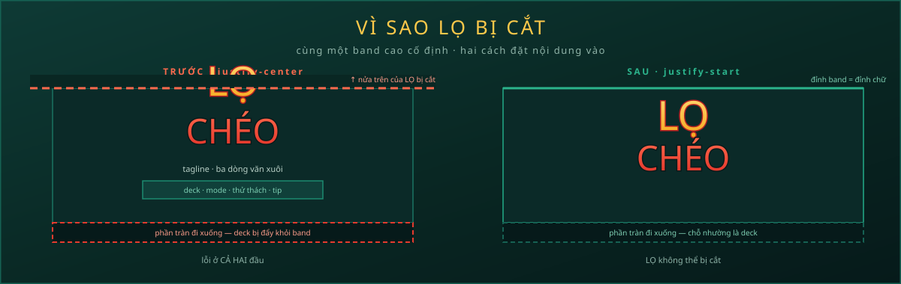

<div align="center">


# LỌ CHÉO — HŨ DƯA ĐẠI CHIẾN

### 🫙 Arcade muối dưa chạy 100% trong trình duyệt — một file HTML duy nhất, offline-first
### 🌐 Giao diện 7 ngôn ngữ ngay trong game — Tiếng Việt · English · 中文 · 日本語 · 한국어 · Español · Français

[🇻🇳 Tiếng Việt](README.md) · [🇬🇧 English](README.en.md) · [🇨🇳 中文](README.zh.md) · [🇯🇵 日本語](README.ja.md) · [🇰🇷 한국어](README.ko.md) · [🇪🇸 Español](README.es.md) · [🇫🇷 Français](README.fr.md) · [🇹🇭 ไทย](README.th.md) · [🇩🇪 Deutsch](README.de.md) · [🇵🇹 Português](README.pt.md)

[](docs/releases/v1.1.8.md)
[](#-changelog-chia-t%E1%BA%A7ng)
[](#-kiểm-chứng-chất-lượng)
[](https://github.com/standardizeparadigm/Lo-CheoIO/actions/workflows/ci.yml)
[](LICENSE)
[](#-cài-đặt--chạy)
[](#-build-production)
[](#-chuyển-ngôn-ngữ)
[](CONTRIBUTING.md)


**v1.1.8** · bản vá cuối trước **1.2.0** · *menu không cuộn được ở bất kỳ cỡ nào* · *dấu nặng `LỌ` không còn bị che* · *dấu sắc `CHÉO` được cứu* · *panel THÔNG TIN hết chia cắt* · *deck thay dải đếm* · 520 test / 48 file

</div>

---

## 🥒 Về dự án

> Lọ Chéo — Hũ Dưa Đại Chiến: arcade muối dưa chạy 100% trong trình duyệt, gói gọn trong một file HTML duy nhất, offline-first — không CDN, không server. Chiếc lọ gốm chỉ chịu đi đường CHÉO: giữ 2 phím để lượn xiên, tăng tốc chém tan mốc, ruồi, sâu rau, hứng đầy hũ trước khi gốm nứt làm ba. **9 chế độ chơi · 14 nguyên liệu · 16 thành tựu · bảng vàng TOP 8 · giao diện 7 ngôn ngữ.**

Đây là tựa **arcade hành động một màn hình** lấy cảm hứng từ hũ dưa món quê Việt Nam. Không có level tuyến tính, không có màn hình menu loằng ngoằng — chỉ có cái lọ, trận mưa dưa bất tận và phản xạ cháy rực của bạn.


## 🆕 Mới trong v1.1.8

> Bản **vá cuối** trước 1.2.0. Không thêm chế độ chơi, không đổi cân bằng, không đổi định dạng lưu. Vòng cuối của bản vá này làm một việc: **hero tự đo cửa sổ và tự chọn bố cục**, ở mọi kích thước, không cuộn, không cắt. Kèm theo là dải deck bị bỏ, và 20 hình SVG được vẽ lại.

### 📐 Một phép cộng không ai quản lý — và bốn lỗi cùng lúc

Ảnh chụp màn hình báo bốn lỗi, nhưng chúng chỉ có **một** nguyên nhân. Hàng panel góc và ticker từng là *flex sibling* của hero với `shrink-0`, nên chúng lấy chiều cao trước rồi mới chia phần dư:

```
cửa sổ 720px
├── 415px   hàng panel GAME/INFO   (tự cao bằng nội dung, shrink-0)
├──  55px   ticker                 (tự cao bằng chữ, shrink-0)
└── 250px   hero                   ← phần còn lại, trong khi cần ~430px
```

| Triệu chứng trong ảnh | Vì sao |
| --- | --- |
| `LỌ` bị cắt ở mép trên | hero 250px, nội dung 430px |
| `CÀI ĐẶT` tràn khỏi panel | panel cao theo nội dung, không theo khung |
| Dòng bản quyền bị cắt đôi | ticker cần 55px nhưng chỉ được cấp 48px |
| Nút `×` của «Cách chơi» nổi giữa màn hình | accordion chứa nó đã cuộn khỏi tầm nhìn |

Cách sửa không phải nới rộng thêm vài pixel cho vừa, mà là **khai báo chiều cao ở một chỗ rồi để mọi thứ đọc lại từ đó**: `layout/metrics.ts` giữ mọi con số, `layout/fit.ts` trả về một `MenuPlan` thuần, `MenuChrome` là một khối `absolute inset-x-0 bottom-0`, và hero tự giữ chỗ bằng `padding-bottom` do **cùng** hàm đó tính ra.


### ✂️ `LỌ` vẫn bị cắt — lần này không phải chuyện chiều cao

Vòng 5 báo lại: ở **1920×1080 fullscreen** và **1920×829** chữ `LỌ` vẫn mất nửa trên. Chiều cao thì đã đúng từ vòng 3, nên đây là lỗi khác — và nó tệ hơn, vì nó là **lỗi do chính tôi tạo ra ở vòng 4**.

Khi tách lockup khỏi `StartScreen` thành `Wordmark.tsx`, class `leading-[0.82]` trên thẻ `<h1>` **bị bỏ lại**. Hai file CSS trong repo vẫn mô tả nó, hai file vẫn giải thích vấn đề dấu nặng dựa trên nó — nhưng `<h1>` thì không có `line-height` nào. Dòng dưới (`.text-shimmer`) thừa kế `normal` (~1.2em) thay vì `0.92`, lockup cao thêm **~20px** so với mọi con số trong repo.

Hero là một band cao cố định và màn hình dùng `justify-center` — nên 20px thừa tràn **đều hai phía**, và đỉnh `LỌ` là thứ bị cắt trước. Ở 1280×720: band 342px, nội dung 349px.

Bản vá làm hai việc, và việc thứ hai quan trọng hơn:

1. **Khôi phục `leading`** trên `<h1>` và trên `.text-shimmer`.
2. **Đổi `justify-center` → `justify-start`.** Căn giữa là thứ biến "cao hơn một chút" thành "cắt cả hai đầu". Neo đỉnh thì phần tràn chỉ đi xuống, nơi deck (trang trí) nhường chỗ — `LỌ` không thể bị cắt nữa, kể cả khi một bản dịch trong tương lai làm nội dung cao lên.



### 📖 Tagline rời hero, thành mục «GIỚI THIỆU» riêng

«Bỏ cái chỗ như trong hình 3 đi, cho nó vào mục thông tin và làm 1 cái riêng nó cho» — đoạn văn ba dòng dưới wordmark.

Nó không phải trang trí: nó giải thích toàn bộ trò chơi. Nên nó không bị xoá — nó **đổi địa chỉ**. Ba dòng văn xuôi trong một band cao cố định là 75px mà wordmark và deck đang tranh nhau; trong một modal thì nó có chỗ để đọc.

`menu/about/` là module mới. Modal **GIỚI THIỆU** (tiếng Anh: **ABOUT**) giờ mở đầu bằng chính đoạn văn đó, rồi mới tới thẻ tác giả — vì người chơi mới cần biết *trò chơi là gì* trước khi biết *ai làm ra nó*.

### ⌨️ Panel THÔNG TIN hết trống

INFO có ba hàng trong một panel thiết kế cho bảy, nên ~126px của nó là hình chữ nhật rỗng — thấy rõ dưới «THOÁT» trong ảnh. Hai thứ được thêm vào, cả hai đều là thông tin menu đáng lẽ phải có từ đầu:

- **`PHÍM TẮT`** — danh sách điều khiển đầy đủ. Trước đó chỗ duy nhất ghi lại là một hàng bốn phím trong modal how-to, chỉ nói về di chuyển; `Space`, `P`, `R`, `Enter`, `M` không được ghi ở đâu cả. Danh sách nằm ở `menu/shortcuts/keys.ts` và được test đối chiếu với **chính key handler của `GameCanvas`** — nên nó không thể quảng cáo một phím không làm gì, và cũng không thể bỏ sót một phím có thật.
- **Bản tóm tắt catalogue** — số chế độ · nguyên liệu · thành tựu, suy ra từ cùng dữ liệu mà danh sách mode và thành tựu đọc.

> Đây **không phải** dải ba số `9 · 14 · 16` từng bị bác. Khác chỗ (panel, không phải hero), khác việc (panel sinh ra để tóm tắt), và không lặp gì người chơi vừa đọc trên màn hình này.

### 🌀 Lỗi cuộn: vùng cuộn lồng trong vùng cuộn

Phần dưới đứng yên mà phần trên vẫn kéo lên xuống được — đúng như mô tả. v1.1.7 bọc nội dung hero trong một khung `overflow-y-auto`, rồi căn giữa nó bằng `min-h-full` + `justify-center`. Cách đó chỉ đúng khi nội dung **thấp hơn** khung; khi nội dung **cao hơn**, `justify-center` đẩy nó lên và đỉnh nằm *phía trên gốc cuộn* — không có vị trí cuộn nào chạm tới được.

Vòng 1 gộp còn **một** vùng cuộn (`.menu-scroll`) neo ở đỉnh, không bao giờ căn giữa theo chiều dọc. Ba lớp CSS từng gây lỗi — `flex-1 overflow-y-auto`, `min-h-full`, `justify-center` — đều bị `tests/menu-layout.test.ts` cấm quay lại.

> **Vòng 3 đi xa hơn: không còn vùng cuộn nào.** `.menu-pane` dùng `overflow: clip` và bất biến `scene + reserve === viewport.height` bảo đảm không có gì để cuộn. Xem mục «Vòng ba» ở trên.

### 🎯 Hero: `LỌ CHÉO` vào giữa, nhấc lên một chút

- Chữ đặt **giữa theo chiều ngang** rồi **nhấc lên** đúng yêu cầu, cỡ chữ chặn theo *cả* chiều rộng lẫn chiều cao nên cửa sổ thấp không làm glyph tràn.
- Chú lọ gốm dời sang phải, quanh nó là **ba vòng halo 18s / 26s / 34s** — bản cũ dùng một vòng 14s, đọc ra thành spinner.
- **14 món trang trí** (sao, tia, vòng, bong bóng, ớt, lá chanh, ruồi, giọt mắm) rải thành hai dải trên và dưới chữ, mỗi món một tốc độ và độ trễ riêng — thay cho lời phàn nàn *"chớ có mỗi chữ LỌ CHÉO và chiếc lọ gốm thì ít quá"*.
- Toạ độ trang trí là **dữ liệu** trong `scene/decor.ts`, có hàm kiểm va chạm, nên `tests/menu-decor.test.ts` khoá được cả vị trí lẫn số lượng.

### 📖 «Cách chơi» chuyển vào menu GAME

Sáu luật chơi và bảng phím không còn nằm trong hero — mở ra là đẩy chữ `LỌ` khỏi màn hình. Chúng thành **một hàng trong panel GAME**, mở ra modal (`HowToModal`), nên bố cục không nhúc nhích dù modal mở hay đóng. Nút `×` lạc giữa màn hình biến mất cùng cái accordion sinh ra nó.

### 🗂️ Dự án lại tách thêm thư mục

```
src/components/menu/
├── layout/          metrics.ts · fit.ts · useMenuPlan.ts      ← MỚI: mọi con số ở một chỗ
├── scene/           decor.ts · DecorGlyph · HeroDecor · JarHalo ← MỚI: hero được trang trí
├── ticker/          strings.ts · tickerTone.ts · MenuTicker     ← MỚI: dải chữ tách riêng
├── howto/           rules.ts                                    ← MỚI: 6 luật + bảng phím
├── background/      layers.ts · MenuBackground                  ← 8 lớp nền, khai báo bằng dữ liệu
├── panel/           stat.ts · PanelStatStrip                     ← MỚI: footer hai panel
├── deck/            daily.ts · tip.ts · MenuDeck                  ← MỚI: thử thách + luật trong ngày
└── MenuChrome.tsx · HowToModal.tsx                              ← MỚI: khối đáy + modal
```

### 🐛 Sửa lỗi

| # | Lỗi | Cách sửa |
| --- | --- | --- |
| 1 | Nửa trên vẫn cuộn được trong khi nửa dưới đứng yên | bỏ vùng cuộn lồng — vòng 3 bỏ luôn vùng cuộn cuối cùng |
| 2 | `LỌ` bị cắt ở mép trên | hero giữ `scene` 342px, không bị ép còn 250px |
| 3 | `CÀI ĐẶT` tràn khỏi panel GAME | `CornerPanel.height` thành tham số **bắt buộc**: 318px (gọn) / 458px (đầy đủ) |
| 4 | Dòng bản quyền bị cắt đôi | ticker cao cố định 48px, bản quyền nằm cùng khối với marquee |
| 5 | Nút `×` của «Cách chơi» nổi giữa màn hình | accordion → modal, không còn nút nào `absolute` trên khung đã trôi |
| 6 | Panel cao theo độ dài bản dịch (Đức/Thái tràn trước tiếng Anh) | chiều cao khai báo, không phụ thuộc nội dung |
| 7 | Một vòng halo 14s đọc thành spinner | ba vòng 18s / 26s / 34s gần như không bao giờ trùng pha |
| 8 | Tài liệu/SVG/launcher lệch phiên bản | quét toàn bộ 10 README + docs + 19 SVG → 1.1.8 |

### 🏷️ Changelog chia tầng — mỗi tầng một màu

| Tầng | Nhãn | Màu | Nghĩa | Ví dụ |
| --- | --- | --- | --- | --- |
| `major` | **MAJOR** | 🩷 hồng `#ff5fb0` | bản lớn — thêm hệ thống | 1.0.0 |
| `minor` | **UPDATE** | 🟡 vàng `#f5a81c` | nâng cấp — thêm nội dung | 1.1.0 |
| `patch` | **PATCH** | 🟣 tím `#9d6bff` | vá lỗi, dọn dẹp | 1.1.1 → **1.1.8** |

Tầng **suy ra từ SemVer** bằng `tierFor(version)`, không gõ tay — nên nhãn không thể lệch khỏi số phiên bản in cạnh nó. Panel có **bộ lọc** TẤT CẢ · MAJOR · UPDATE · PATCH kèm số bản mỗi tầng.


→ Chi tiết đầy đủ: [docs/releases/v1.1.8.md](docs/releases/v1.1.8.md) · Bản trước: [docs/releases/v1.1.7.md](docs/releases/v1.1.7.md)

### 🧭 Vòng ba: menu **không cuộn được** — và đây là chỗ nó dứt điểm

Yêu cầu: *"Lần này cần menu phải dứt điểm, không có fix xong lỗi này rồi lại lòi ra lỗi kia."*

Đúng là như vậy. Vòng 1 và vòng 2 đều hỏi **"làm sao giấu thanh cuộn"**. Câu hỏi đó sai, và chính nó sinh ra chuỗi lỗi tiếp theo. Chẩn đoán thật:

```
vòng 1 + 2:  scene = max(320, height − reserve)      ← kẹp SÀN
             nếu height < reserve + 320  →  cột CAO HƠN cửa sổ
             →  tràn  →  thanh cuộn  →  che nó đi  →  tràn lộ ra chỗ khác
```

Mỗi vòng chỉ **dời** chỗ tràn: lần đầu là chữ `LỌ` bị cắt, lần sau là dòng bản quyền, lần nữa là thanh cuộn. Không vòng nào bỏ được phần tràn, vì vòng nào cũng giữ một sàn cứng *và* cho phép cột vượt cửa sổ.

**Vòng 3 đổi bất biến, không đổi CSS:**

```
scene + reserve === viewport.height        (mọi viewport, không ngoại lệ)
```

`planMenuLayout()` không còn được phép trả về một kế hoạch không vừa. Khi cửa sổ không đủ chỗ, plan **hạ cấp** theo thứ tự cố định — và thứ tự đó chính là điều làm nó dứt điểm:

| Bước | Hy sinh | Được lại | Không bao giờ hy sinh |
| --- | --- | --- | --- |
| 1 | hàng 34px → **26px** | 56px trên 7 hàng | vẫn đủ **mọi** nút |
| 2 | **ticker** biến mất | 48px + lề | nội dung có lại trong modal |
| 3 | **footer** panel biến mất | 30px | con số đó đã in trên hàng |
| 4 | hero chỉ còn **wordmark** | 80px | chữ ký thương hiệu vẫn còn |
| — | `fit: "crop"` | — | chỉ dưới **240px**, không máy thật nào |



Điều làm nó khác hai vòng trước là **bất biến được kiểm bằng test**, không bằng mắt:

- `tests/menu-no-scroll.test.ts` chạy 15 viewport thật (kể cả điện thoại nằm ngang 844×390), rồi quét 300→2000px theo bước 5px trên 5 bề rộng — hàng nghìn tổ hợp, và khẳng định `scene + reserve === height` ở từng tổ hợp.
- `.menu-pane` dùng `overflow: clip` — **không tạo vùng cuộn**. Không phải `hidden` (vẫn cuộn được bằng bàn phím), không phải `auto`.
- Test **cấm** rule giấu thanh cuộn quay lại `.menu-pane`. Một rule như thế nghĩa là ai đó vẫn đang chờ có tràn.

> **Vì sao `overflow: clip` chứ không phải "giấu thanh cuộn":** nếu tương lai có ai làm nội dung cao hơn cửa sổ, `clip` **cắt** nó — ồn ào và truy được ngay. Thanh cuộn bị giấu thì lặng lẽ: nó chỉ hiện trên máy có font metrics lệch hai pixel, và đó chính là kiểu lỗi đã sống sót qua hai vòng.

### ✍️ Dấu nặng của `LỌ` — ba thứ cộng lại, không phải một

Ảnh chụp thứ ba cho thấy dấu nặng dưới `Ọ` bị dải vàng của `CHÉO` che mất. Không có một dòng nào "sai"; ba thứ đúng riêng lẻ cộng lại thành lỗi:

| Thứ | Vai trò | Vì sao nó quan trọng |
| --- | --- | --- |
| `leading-[0.82]` trên `h1` | hai dòng wordmark đọc như một khối | hộp dòng **ngắn hơn** glyph, nên dấu nặng (0.18em dưới baseline) thò ra ngoài |
| `-mt-1` trên `CHÉO` | kéo hai dòng sát lại | hai hộp dòng **chồng nhau ~14px** |
| `inset: -0.08em …` trên `.text-shimmer::before` | dải vàng rộng hơn chữ | dải **nhô lên ~10px**, đúng vào chỗ dấu nặng nằm |

Cách sửa không phải `z-index`. Dấu không bị che vì **hình học**, không vì thứ tự lớp:

- `.text-shimmer::before` bắt đầu từ `top: 0` — không vẽ gì phía trên hộp `CHÉO`.
- `.wordmark-lo` giữ chỗ cho dấu **bên trong** hộp của nó bằng `padding-bottom`, và dòng dưới thôi kéo lên bằng margin âm.
- Khoảng cách thị giác giữ nguyên; hai hộp chỉ thôi chồng nhau.

`tests/wordmark-diacritics.test.ts` khoá cả bốn mặt: chuỗi locale có dấu thật, rule có màu đặc, không rule nào vừa clip vừa `transparent`, và `inset` không được trả lại giá trị âm ở phía trên.

### 🪟 Hai ảnh, cùng một cửa sổ, khác nhau 260 pixel

Hai ảnh chụp cuối cùng của vòng này là **cùng một ứng dụng**: `1920×1080` khi bấm toàn màn hình, và `1920×820` khi thu về cửa sổ. Chiều rộng không đổi một pixel nào. Nhưng bức thứ hai có nửa dưới của hero nằm **dưới** hai panel góc, và chip `CHẾ ĐỘ CHƠI` bị cắt làm đôi.

Nguyên nhân không phải thiếu chiều cao. Đó là **câu hỏi sai**:

| Thứ quyết định bố cục | Biết gì | Không biết gì |
| --- | --- | --- |
| `sm:` · `lg:` trong CSS | chiều **rộng** | chiều **cao** |
| `plan.minimal` | chiều **cao** (dưới 220px) | chiều rộng, và chỉ bật khi đã quá muộn |
| `heroLayout()` (mới) | **cả hai**, từ cùng con số panel dùng | — |

Một quyết định phụ thuộc *hai trục* thì không thể viết bằng media query một trục. Nên bố cục hero rời khỏi CSS và thành một hàm thuần:

```ts
export function heroLayout({ scene, width, minimal }: HeroInput): HeroLayout {
  if (minimal) return { sideBySide: false, halo: false, badgeRow: false, mascot: false, liveBadge: false };

  const sideBySide = width >= WIDTH_FOR_SIDE_BY_SIDE && scene >= HEIGHT_FOR_SIDE_BY_SIDE;

  return {
    sideBySide,
    halo:       scene >= HEIGHT_FOR_HALO,
    badgeRow:   scene >= HEIGHT_FOR_BADGE_ROW,
    mascot:     true,          // không bao giờ ẩn logo
    liveBadge:  scene >= HEIGHT_FOR_BADGE_ROW,
  };
}
```

`scene` là chiều cao hero mà `planMenuLayout()` đã cấp — **đúng con số** chrome đang giữ chỗ. Không thể lệch, vì cả hai đọc từ một hàm.

#### Ba ngưỡng, cả ba đều được suy ra

Không có số tròn nào ở đây. Mỗi hằng số bằng chiều cao thật của thứ nó canh:

| Hằng số | Giá trị | Suy ra từ |
| --- | --- | --- |
| `HEIGHT_FOR_BADGE_ROW` | **232** | wordmark 150 + badge 40 + live badge 22 = 212, cộng 20px thở |
| `HEIGHT_FOR_HALO` | **300** | lockup 150 + vòng halo 240 − chồng lấn 90 |
| `HEIGHT_FOR_SIDE_BY_SIDE` | **300** | cột cao hơn: mascot 192 + chip 24 + đệm |

Con số `232` là một **lỗi đã bị bắt**. Bản nháp đầu đặt nó bằng `210` — dưới chính cái lockup 212px mà nó canh. Kết quả: band 210px vẽ lockup 212px, dòng kỷ lục bị cắt mất. Đúng loại lỗi mà cả vòng này đang sửa, do chính bản sửa sinh ra.

`tests/menu-adaptive.test.ts` quét **1 682 viewport** — mọi tổ hợp 15 chiều rộng thật × 13 chiều cao thật, rồi bước 61px × 19px qua `320..3840` × `150..700` — và khẳng định `heroContentHeight(layout) ≤ scene` ở từng mẫu.

#### Sự kiện thứ tư bị thiếu

Người dùng tạo ra hai ảnh đó bằng cách **bấm phím toàn màn hình**. Ứng dụng nghe `resize` và `orientationchange`. Firefox không bắn cái nào trong hai khi vào toàn màn hình; Safari bản cũ chỉ bắn `webkitfullscreenchange`.

Nên cửa sổ đổi chiều cao, hero giữ kế hoạch cũ, và chip bị cắt cho tới lần resize kế tiếp.

```ts
export const VIEWPORT_EVENTS = [
  "resize",
  "orientationchange",
  "fullscreenchange",
  "webkitfullscreenchange",
  "mozfullscreenchange",
  "MSFullscreenChange",
] as const;
```

Danh sách này nằm một chỗ, vì `useMenuPlan()` và `useViewportWidth()` **cả hai** cần nó — và trước đây mỗi hàm tự đăng ký bản sao của mình, tức là hai bản có thể mô tả hai cửa sổ khác nhau.

### 🗑️ Dải ngăn cách ở ảnh 12 — và cái deck đi cùng nó

Ảnh thứ ba là một dải `1443×180` cắt ra từ giữa màn hình: dấu `🎮`, một đường vàng, rồi ba tiêu đề `GAME / THỦ THÁCH HÔM NAY / LUẬT CHƠI`. Đó là **deck** — ba cột chữ trong một band cao cố định.

Nó không thể ở đó, và hai ảnh kia nói tại sao: ở `1920×1080` cột phải bị cắt **giữa câu**, ở `1920×820` cả hàng nằm dưới panel. Một band đủ cao cho wordmark 200px không đồng thời đủ cao cho ba đoạn văn.

Không có gì trong deck bị mất:

| Deck nói gì | Bây giờ ở đâu |
| --- | --- |
| chế độ đang chơi | chip dưới mascot, danh sách đầy đủ trong menu GAME |
| **thử thách hôm nay** | một dòng trong panel THÔNG TIN — `mode · mốc điểm` |
| luật chơi trong ngày | một dòng của modal Cách chơi, bản đầy đủ của đúng sáu luật đó |

Logic ngày tháng thì **không** đi cùng. `challengeFor()` và `tipIndexFor()` chuyển sang `src/game/daily/` — chúng là hàm thuần của ngày địa phương, không liên quan gì tới việc hiển thị. Cả 21 test đi theo, giữ nguyên tên.

Chỗ trống dưới wordmark bây giờ là **có chủ ý**. Đó là cái giá của một hero vừa ở mọi kích cỡ.

### 🔁 Vòng hai: bốn lỗi còn lại của cùng một màn hình

Ảnh chụp thứ hai báo bốn lỗi nữa. Cả bốn đều là **lỗi thầm lặng** — không có ngoại lệ nào được ném ra, chỉ có thứ gì đó trông sai.

| # | Triệu chứng | Nguyên nhân thật | Vì sao khó thấy |
| --- | --- | --- | --- |
| 1 | `CHÉO` đọc thành `CHEO` — mất dấu sắc | `.text-shimmer` tô chữ bằng `background-clip: text` + `color: transparent`; mask của cách đó dựng từ **đường bao glyph**, mà `É` là `E` + `U+0301` tổ hợp, nên mask cắt mất dấu | cả hai lỗi đều *im lặng*: chữ vẫn hiện, chỉ thiếu một nét. Và vì `color` là `transparent`, **không có** bản chữ nào để fallback |
| 2 | Panel THÔNG TIN bị chia cắt | body dùng `justify-around`, rải 3 hàng trên chiều cao dành cho 7 — GAME 7 hàng nhìn đúng, INFO 3 hàng bị ba khoảng trống | bố cục vẫn "cân", chỉ là cân sai; không có gì tràn nên không có gì báo |
| 3 | Thanh cuộn vẫn hiện dù đã ẩn | `.menu-scroll` có **ba** khối rule đánh nhau (`width: 8px` → `width: 0` → thumb màu ở cuối file thắng theo thứ tự nguồn) cộng một `::-webkit-scrollbar` toàn cục | CSS không có "khai báo trùng" nào là lỗi biên dịch — khối thắng là khối đứng **sau**, không phải khối hợp lý hơn |
| 4 | «hoặc nhấn ENTER» — bấm không có gì xảy ra | **không tồn tại** handler Enter nào trên màn hình bắt đầu; chỉ `GameOverScreen` có | nhãn đúng chính tả, đúng thiết kế — chỉ là nó hứa một phím tắt chưa từng được viết |

Cách sửa cho lỗi 1 là bỏ hẳn kỹ thuật chứ không phải tinh chỉnh nó: chữ tô **vàng đặc**, hiệu ứng chuyển sang một lớp `::before` phía sau và một `text-shadow` nhấp nháy. Một dấu không thể rơi khỏi **màu chữ**, vì nó *là* màu chữ. `tests/wordmark-diacritics.test.ts` khoá cả bốn mặt: chuỗi locale có dấu thật, rule có màu đặc, không rule nào vừa clip vừa `transparent`, và hiệu ứng vẫn chạy.



### 📊 Khoảng trống dưới hero — lấp bằng số thật

Thanh cuộn bị ẩn thì màn hình vẫn còn một khoảng lặng dưới tagline. Cách lấp **không** phải thêm chữ trang trí mà là thêm thứ đọc được: `.menu-hero` đổi từ `min-height` sang `min-height` + `flex: 1 0 auto` để nhận hết phần cao còn lại, và dưới tagline là **ba chỉ số** lấy từ catalogue sống — `MODE_LIST.length` · `KINDS.length` · `ACHIEVEMENTS.length` — nên không bao giờ lệch khi thêm nội dung. Dưới 640px dải này ẩn: chỗ đó còn quý hơn.

Hai panel cũng nhận **footer** thay vì để khoảng dư rơi rải rác: GAME hiện `✓7/16 · ◆9` (thành tựu / chế độ), INFO hiện `v1.1.8 · ◆PATCH` lấy tier từ chính module changelog nên chip không thể lệch với panel phía trên nó. `stat.ts` kẹp giá trị: một bản lưu cũ từng in được `18/16`.




## ✨ Tính năng nổi bật

| Nhóm | Chi tiết |
| --- | --- |
| 🎮 **9 chế độ chơi** | **MUỐI DƯA CỔ ĐIỂN** (cân bằng) · **THẢNH THƠI** (không đồ hư, ×0.5) · **ỚT LỬA** (nhanh +35%, ×1.5) · **ĐUA 60 GIÂY** (time-attack 60s, ×1.25) · **MÙA VÀNG** (đồ vàng ×2.6) · **MƯA DƯA** (dày ~1.4×, ×0.75) · **GỐM MỎNG** (1 vết nứt là vỡ, ×2.0) · **LỄ HỘI COMBO** (cửa sổ combo ×2, ×1.15) · **ĐẠI TIỆC DƯA** (dưa dày ~×2, hũ thưởng ×2.5, ×0.6) |
| 🌐 **i18n trong game** | Tiếng Việt · English · 中文 · 日本語 · 한국어 · Español · Français — `src/i18n/` (module thuần + context), `t()` có interpolation, đồng bộ `<html lang>`, số theo locale (vi-VN / en-US / zh-CN / ja-JP / ko-KR / es-ES / fr-FR) |
| 🕹️ **Cơ chế CHÉO độc quyền** | Giữ 2 phím/trục chéo — lọ tăng tốc, phát sáng, chém tan đồ hư. Có thanh stamina riêng với hysteresis chống nhấp nháy |
| 🥬 **14 nguyên liệu** | Cà pháo, ớt, tỏi, gừng, muối, cải, **CẢI VÀNG** (làm đầy hũ cực nhanh) · MUỐI/TỎI VÀNG · ỚT HIỂM · ĐÁ LẠNH · MỐC, RUỒI, **SÂU RAU** (hazard) |
| 🧄 **Khiên Tỏi Vàng** | Power-up: tích tối đa **2 lớp khiên** chặn vết nứt, vòng hào quang xoay quanh lọ |
| 🏆 **16 thành tựu** | Lưu **cộng dồn qua các ván** (localStorage), toast "THÀNH TỰU MỚI!" ở màn thua |
| 🔊 **Âm thanh thủ công** | 11 hiệu ứng Web Audio API tổng hợp thuần (không file) + nền pentatonic đổi tông theo cấp, mute bằng `M` |
| 💾 **Bảng vàng TOP 8** | Điểm lưu cục bộ, validate & chuẩn hoá khi đọc, tên tự viết hoa, highlight dòng vừa lập kỷ lục |
| 🎨 **Đồ hoạ 60fps** | Canvas 2D, particle budget 460, DPR cap 2, nền gạch bông pre-render offscreen, star twinkle + aurora menu |
| 📴 **Offline-first thật sự** | Fonts tự host (subset latin + vietnamese, woff2), không CDN, không API — mở `dist/index.html` là chơi |
| 🧪 **Chất lượng** | 520 unit tests (vitest) cho modes / achievements / storage / i18n / settings — `npm run check` là cổng CI |


## 🌐 Chuyển ngôn ngữ

Lọ Chéo hỗ trợ **7 ngôn ngữ giao diện** ngay trong game — không cần tải lại trang, không mất ván đang chơi:


| Ngôn ngữ | Ở đâu | Lưu vào |
| --- | --- | --- |
| 🇻🇳 Tiếng Việt | nút **VI** (mặc định, theo trình duyệt nếu có) | `locheo.lang.v1` |
| 🇬🇧 English | nút **EN** | `locheo.lang.v1` |
| 🇨🇳 中文 | nút **中** | `locheo.lang.v1` |
| 🇯🇵 日本語 | nút **日** | `locheo.lang.v1` |
| 🇰🇷 한국어 | nút **한** | `locheo.lang.v1` |
| 🇪🇸 Español | nút **ES** | `locheo.lang.v1` |
| 🇫🇷 Français | nút **FR** | `locheo.lang.v1` |

- Đổi ngôn ngữ trong **Cài đặt → NGÔN NGỮ** (lưới 7 nút có cờ) — một chỗ duy nhất, không còn nút nổi ngoài menu.
- Toàn bộ chuỗi hiển thị đều qua dictionary `src/i18n/locales/{vi,en,zh,ja,ko,es,fr}.ts` — engine canvas, màn hình, HUD, popup, ticker, mẹo.
- Thiếu key? `t()` tự fallback về tiếng Việt — key set 7 locale luôn được test đồng bộ (placeholder included).

## 🕹️ Điều khiển

| Hành động | Bàn phím | Cảm ứng |
| --- | --- | --- |
| Di chuyển | `W` `A` `S` `D` hoặc `← ↑ ↓ →` | Kéo ngón tay bất kỳ đâu trên màn hình (joystick nổi) |
| **Chéo (CHÉO)** | Giữ **2 phím cùng lúc** (vd. `A`+`W`) | Kéo **chéo 45°** — vòng joystick chuyển vàng |
| Lắc hũ (shockwave + hút đồ) | `Space` | Nút **LẮC** đỏ góc phải dưới |
| Tạm nghỉ / tiếp tục | `P` hoặc `Esc` | Nút pause góc trên phải |
| Chơi lại ngay | `R` (kể cả khi đang pause/game over) | Nút "Muối lại ngay" |
| Bắt đầu / xác nhận | `Enter` | Nút **VÀO BẾP** |
| Tắt / bật âm | `M` | Nút loa góc trên phải |
| Đổi ngôn ngữ | — (dùng nút VI/EN/中/日/한/ES/FR) | Nút VI/EN/中/日/한/ES/FR ở menu / pause |

## 🚀 Cài đặt & chạy

### Chơi ngay (không cần build)

```bash
# mọi bản release đều đính kèm một file duy nhất:
open dist/index.html      # macOS
xdg-open dist/index.html  # Linux
start dist/index.html     # Windows
```

### Build production

```bash
npm install        # cài dependencies (Node ≥ 20.19)
npm run build      # → dist/index.html (một file tự chứa mọi thứ)
```

> `vite-plugin-singlefile` inline toàn bộ JS/CSS/fonts/ảnh vào **một** file `dist/index.html` (~700 KB, gzip ~355 KB). Không cần server, không cần mạng.

### Development

```bash
npm run dev        # dev server với HMR (http://localhost:5173)
npm run preview    # xem thử bản build bằng server tĩnh
npm run typecheck  # tsc --noEmit (strict, noUnusedLocals…)
npm run test       # vitest — 520 unit tests (modes / achievements / storage / i18n / settings)
npm run check      # typecheck + test + build (cổng chất lượng ci)
```

## 🗂️ Cấu trúc project

```
lo-cheoio/
├─ index.html              # entry, meta SEO/OG (không CDN)
├─ package.json            # lo-cheoio v1.1.8, scripts dev/build/test/check
├─ .gitattributes          # *.bat/*.cmd → CRLF · posix scripts → LF · binary
├─ vite.config.ts          # vite + react + tailwind v4 + singlefile
├─ tsconfig.json           # strict; include src + tests
├─ favicon.ico             # web icon (multi-size 16→256)
├─ public/                 # favicon.ico/png/svg served at web root
├─ assets/
│  ├─ banner.svg           # banner README (SMIL animation)
│  ├─ demo.svg             # mô phỏng gameplay (SMIL animation)
│  ├─ items.svg            # 14 nguyên liệu (SMIL animation)
│  ├─ modes.svg            # 9 chế độ chơi (SMIL animation)
│  ├─ languages.svg        # 7 ngôn ngữ trong game (SMIL animation)
│  ├─ new-modes.svg        # 2 chế độ mới v1.1.4 (SMIL animation)
│  ├─ corner-menu.svg     # corner GAME/INFO panels (SMIL animation, v1.1.5)
│  ├─ settings-sections.svg # 6-section settings tour (SMIL, v1.1.6)
│  ├─ palette-ribbon.svg   # 7 dải màu chạy sáng (SMIL, v1.1.8)
│  ├─ architecture.svg     # sơ đồ kiến trúc + luồng dữ liệu (SMIL, v1.1.8)
│  ├─ release-tiers.svg    # 3 tầng + thời gian biểu 10 bản (SMIL, v1.1.8)
│  ├─ divider.svg          # divider lóe sáng (SMIL animation)
│  ├─ license.svg          # dấu AGPL-3.0 copyleft (SMIL animation)
│  └─ favicon.svg          # favicon (SMIL animation)
├─ scripts/
│  ├─ play-mac.command     # trình chạy macOS — 7 ngôn ngữ, menu màu có hoạt ảnh
│  ├─ play-windows.bat     # trình chạy Windows — CRLF + UTF-8 BOM, 7 ngôn ngữ
│  ├─ play-linux.sh        # trình chạy Linux — 7 ngôn ngữ, menu màu có hoạt ảnh
│  ├─ smoke-ssr.tsx        # headless SSR smoke toàn bộ menu/modal (v1.1.5)
│  ├─ check-readme-sync.mjs # gate lệch version giữa 10 README (CI) (v1.1.5)
│  └─ README.md            # hướng dẫn trình chạy cho người không rành terminal
├─ docs/
│  ├─ README.md            # mục lục toàn bộ tài liệu (v1.1.5)
│  ├─ DESCRIPTION.md       # mô tả dự án đa ngôn ngữ (vi/en/zh + SEO)
│  ├─ design/              # spec menu-corners / save-format / settings-format
│  ├─ guides/              # engine overview · a11y · performance · storage keys · release playbook…
│  └─ releases/
│     ├─ v1.0.0.md         # release notes bản đầu tiên
│     ├─ v1.1.0.md         # release notes v1.1.0
│     ├─ v1.1.1.md         # release notes v1.1.1
│     ├─ v1.1.2.md         # release notes v1.1.2
│     ├─ v1.1.3.md         # release notes v1.1.3
│     ├─ v1.1.4.md         # release notes (1.1.4)
│     ├─ v1.1.5.md         # release notes (1.1.5)
│     ├─ v1.1.6.md         # release notes (1.1.6)
│     └─ v1.1.8.md         # current release notes (1.1.8)
├─ README.md               # 🇻🇳 Tiếng Việt (file này)
├─ README.en.md            # 🇬🇧 English
├─ README.zh.md            # 🇨🇳 中文
├─ README.ja.md            # 🇯🇵 日本語
├─ README.ko.md            # 🇰🇷 한국어
├─ README.es.md            # 🇪🇸 Español
├─ README.fr.md            # 🇫🇷 Français
├─ README.th.md            # 🇹🇭 ไทย
├─ README.de.md            # 🇩🇪 Deutsch
├─ README.pt.md            # 🇵🇹 Português
├─ src/
│  ├─ main.tsx             # React root, StrictMode
│  ├─ App.tsx              # phase machine menu/playing/paused/gameover
│  ├─ version.ts           # APP_VERSION = "1.1.8" (nguồn duy nhất)
│  ├─ index.css            # tailwind v4 theme + toàn bộ animation/gradient
│  ├─ assets/fonts/        # woff2 subset (Be Vietnam Pro ×6, Bungee)
│  ├─ styles/fonts.css     # @font-face + unicode-range, offline 100%
│  ├─ i18n/
│  │  ├─ i18n.ts           # module thuần: detect, persist, t() + interpolation
│  │  ├─ useI18n.ts        # React hook: useI18n/useLanguage
│  │  └─ locales/          # vi.ts (nguồn key) · en · zh · ja · ko · es · fr
│  ├─ components/
│  │  ├─ GameCanvas.tsx    # canvas + joystick nổi + bàn phím + visibility
│  │  ├─ StartScreen.tsx   # menu: hero + hiện trường nhiều lớp + corner panels
│  │  ├─ menu/              # màn hình bắt đầu, tách theo trách nhiệm
│  │  │  ├─ layout/         # metrics · fit · useMenuPlan (v1.1.8)
│  │  │  ├─ scene/          # 14 món trang trí + 3 vòng halo (v1.1.8)
│  │  │  ├─ ticker/         # dải chữ chạy + bản quyền (v1.1.8)
│  │  │  ├─ howto/          # 6 luật chơi + bảng phím (v1.1.8)
│  │  │  ├─ background/     # 8 lớp nền menu, khai báo bằng dữ liệu (v1.1.8)
│  │  │  ├─ panel/          # footer thống kê hai panel: stat · PanelStatStrip (v1.1.8)
│  │  │  └─ deck/           # thử thách hôm nay + luật trong ngày (v1.1.8 vòng 3)
│  │  ├─ ModeSelector.tsx  # 9 thẻ chế độ (classic… hardcore · combo · feast)
│  │  ├─ AchievementsPanel.tsx  # tường huy hiệu locked/unlocked
│  │  ├─ GameOverScreen.tsx     # VỠ HŨ! + điểm + new achievements
│  │  ├─ PauseScreen.tsx        # TẠM NGHỈ + stats ván
│  │  ├─ settings/           # 6 mục cài đặt + control tái dùng (v1.1.6)
│  │  └─ ui/               # 8 primitive, 48 file mỗi cái (v1.1.8 — tách từ ui.tsx)
│  │                          jar · panel · button · keycap · stat · modal · switch · scoreboard
│  ├─ game/
│  │  ├─ engine.ts         # toàn bộ simulation + render canvas (~2260 dòng)
│  │  ├─ modeTypes.ts      # ModeId · ModeConfig (types-only, v1.1.8)
│  │  ├─ modes/            # 9 record cân bằng — classic.ts … feast.ts (v1.1.8)
│  │  ├─ modesIndex.ts     # MODES · MODE_LIST · isModeId (v1.1.8)
│  │  ├─ modeMath.ts       # multiplierForCombo · jarBonus · comboWindowFor… (v1.1.8)
│  │  ├─ modes.ts          # barrel — giữ nguyên mọi import cũ
│  │  ├─ achievements.ts   # 16 huy hiệu + checker thuần (pure)
│  │  ├─ storage.ts        # localStorage: top 8, progress, achievements
│  │  ├─ audio.ts          # Web Audio synth: sfx + pentatonic music
│  │  ├─ changelog/          # in-game changelog (v1.1.8 — tách từ 48 file)
│  │  │  ├─ types.ts        #   ChangelogEntry · ReleaseTier · copyFor()
│  │  │  ├─ tiers.ts        #   tierFor() · TIER_ORDER · TIER_LABEL_KEY
│  │  │  ├─ entries/        #   48 file / 1 bản — v1_0_0.ts … v1_1_7.ts
│  │  │  └─ index.ts        #   danh sách có thứ tự + 5 helper
│  │  ├─ runSave.ts         # suspended-run persistence
│  │  ├─ settings.ts        # game settings schema + normalize
│  │  ├─ settingsIO.ts      # settings backup/restore codec (v1.1.6)
│  │  ├─ settingsPresets.ts # 4 quick presets (v1.1.6)
│  │  └─ audioLevels.ts     # phép tính gain thuần (v1.1.6)
│  └─ utils/
│     ├─ cn.ts             # clsx + tailwind-merge
│     └─ useFocusTrap.ts   # trap Tab trong modal (v1.1.6)
└─ tests/                  # vitest — 57 files · 586 test (modes · achievements · storage · i18n · runSave · settings · presets · audio · changelog-tiers…)
```

## 🧱 Kiến trúc & hiệu năng


- **Vòng lặp game** trên `requestAnimationFrame` với delta-time kẹp `1/20s`, nhân `timeScale` (slow-mo khi ĐÁ LẠNH) và **hit-stop** `freeze` vài chục ms trên mỗi catch để cảm giác "nện".
- **Canvas HUD** vẽ trực tiếp mỗi frame; React chỉ render các màn hình theo `phase` — không re-render React trong hot loop; khi đổi ngôn ngữ, HUD tự đọc dictionary ở frame kế tiếp.
- **i18n tách lớp**: `src/i18n/i18n.ts` là module thuần (không phụ thuộc React), `useI18n` chỉ là cầu nối đăng ký re-render qua sự kiện `locheo:languagechange`; `t()` hỗ trợ nội suy `{param}` và fallback vi.
- **Chế độ chơi khai báo thuần**: mỗi mode là một record trong `src/game/modes/<id>.ts` (từ v1.1.8; `modes.ts` chỉ còn là barrel) (scoreMult/speedMult/hazardMult/spawnMult + tuỳ chọn timeLimit/goldMult/maxCracks/**comboWindowMult**/**jarBonusMult**) — thêm chế độ mới không cần đụng engine.
- **Nền gạch bông** pre-render một lần ra offscreen canvas (kèm vignette + pool ánh sáng), star twinkle và bubble tính theo thời gian thực, rất rẻ.
- **Budget**: ≤460 particles, ≤70 items, ≤34 popups, DPR ≤ 2; va chạm quét theo hitbox; decal dưa văng trên nền tự dọn.
- **localStorage** với validate/chuẩn hoá đầu vào — 1 bản ghi lỗi không làm hỏng cả bảng; storage bị chặn (Safari private) thì chơi tiếp bộ nhớ; lựa chọn ngôn ngữ lưu riêng ở `locheo.lang.v1`.
- **Giảm chấn motion**: `prefers-reduced-motion` tắt aurora/shimmer/spin; sao nền và shake đều có thể tắt theo media query.

## ✅ Kiểm chứng chất lượng

Mỗi thay đổi phải qua **năm cổng** trước khi vào `main` — chạy hết bằng một lệnh:

```console
$ npm run check        # typecheck + toàn bộ test
$ npm run check:readme # 10 README đồng bộ phiên bản + liên kết release
$ npm run check:i18n   # 7 locale × 306 khoá, không thiếu không thừa
$ npm run check:assets # 19 SVG — không file mồ côi, không tham chiếu hỏng
$ npm run smoke        # SSR smoke: mọi menu/modal render được
```

| Cổng | Phạm vi | Trạng thái 1.1.8 |
| --- | --- | --- |
| `typecheck` | `src/` + `tests/` (TypeScript strict) | ✅ |
| `vitest run` | **520 test / 48 file** | ✅ |
| `smoke-ssr` | menu, 6 mục cài đặt, changelog, 9 modal | ✅ |
| `check-readme-sync` | 10 README × badge/link/SVG | ✅ |
| `check-i18n` | 7 locale × 306 khoá | ✅ |
| `check-assets` | 19 SVG, 2 chiều tham chiếu | ✅ |
| `build` | `dist/index.html` ~867 KB · gzip ~399 KB | ✅ |

Điểm đáng chú ý của bộ test v1.1.8: **`tests/menu-layout.test.ts`** khoá toàn bộ phép cộng chiều cao (520 test) và cấm ba lớp CSS từng gây lỗi cuộn quay lại; **`tests/changelog-tiers.test.ts`** khoá ánh xạ `tierFor()` (kể cả đầu vào rác), bắt mỗi bản phải có **≥5 gạch mô tả**, kiểm tra không gạch nào trùng nhau, và bắt buộc **thứ tự ngày nghiêm ngặt** — chính test này đã phát hiện 1.1.5 và 1.1.6 đang trùng ngày.

## ❓ FAQ

**Không có mạng thì chơi được không?**
Có — 100%: mở `dist/index.html` là chạy đầy đủ, kể cả font và âm thanh. Không có request mạng nào.

**Game có quảng cáo hay telemetry không?**
Không. Không tracking, không analytics — điểm số chỉ nằm trong localStorage máy bạn.

**Đổi ngôn ngữ có mất tiến trình không?**
Không. Điểm, thành tựu, tiến độ và chế độ chơi đều độc lập với `locheo.lang.v1`.

**Bảng vàng TOP 8 lưu ở đâu?**
`locheo.scores.v1` (điểm), `locheo.progress.v1` (tổng ván/hũ/chém), `locheo.achievements.v1` (huy hiệu) — xoá storage là mất, nên trân trọng cái lọ!

**Muốn thêm ngôn ngữ mới?**
Thêm `src/i18n/locales/xx.ts` mirror key set của `vi.ts`, cập nhật `LANGUAGES` + test, mở PR — xem [CONTRIBUTING.md](CONTRIBUTING.md).

**Trình chạy Windows báo lỗi tiếng Việt thì sao?**
Từ v1.1.4 `play-windows.bat` là CRLF + UTF-8 BOM với `chcp 65001` và dấu tiếng Việt nguyên vẹn — lỗi `'Ọ' is not recognized...` đã được sửa triệt để. Nếu tự sửa file .bat bằng editor khác, giữ nguyên CRLF & BOM (`.gitattributes` ép tự động).

**Không biết gõ lệnh thì chạy game kiểu gì?**
Nhấn đúp vào [`scripts/play-mac.command`](scripts/play-mac.command) (macOS), [`scripts/play-windows.bat`](scripts/play-windows.bat) (Windows) hoặc [`scripts/play-linux.sh`](scripts/play-linux.sh) (Linux) — menu 7 ngôn ngữ hiện ra, chọn `1` để build & chơi ngay, `2` để dev tại localhost:5173, nhấn `L` để đổi ngôn ngữ. Chi tiết: [scripts/README.md](scripts/README.md).

## 📦 Releases & changelog

Mỗi bản có một tầng: <kbd>MAJOR</kbd> 🩷 hồng · <kbd>UPDATE</kbd> 🟡 vàng · <kbd>PATCH</kbd> 🟣 tím — đúng quy ước dùng trong panel changelog của game.

| Bản | Tầng | Ngày | Ghi chú |
| --- | --- | --- | --- |
| [v1.1.8](docs/releases/v1.1.8.md) | 🟣 **PATCH** | 2026-11-12 | **Màn hình bắt đầu hết tràn**: một phép cộng chiều cao sai làm hero chỉ còn 250px và `LỌ` bị cắt · **lỗi cuộn** (vùng cuộn lồng + `justify-center`) sửa bằng **một** `.menu-scroll` duy nhất · **«Cách chơi» vào menu GAME** dưới dạng modal · panel **318px/458px** khai báo thay vì tự cao · ticker 48px · **14 món trang trí hero** + **3 vòng halo** · `src/components/menu/{layout,scene,ticker,howto}/` · **520 test / 48 file** |
| [v1.1.7](docs/releases/v1.1.7.md) | 🟣 **PATCH** | 2026-11-10 | **Nền menu hết mờ** (4 lớp phủ cộng hưởng: `blur 64→22px`, vignette góc thay vignette toàn màn hình, khung CRT 140→90px, sàn 45→70%) · **changelog chia tầng có màu** · **96 gạch mô tả mới** cho 8 bản cũ · ngày phát hành xếp lại · `src/game/changelog/` tách thư mục · README 10 ngôn ngữ làm lại · **256 tests** |
| [v1.1.6](docs/releases/v1.1.6.md) | 🟣 **PATCH** | 2026-11-08 | **Cài đặt 6 mục** (nhanh · âm thanh · giao diện · ngôn ngữ · sao lưu · dữ liệu) · âm lượng 0–100 · mức rung · chất lượng hình · tự pause khi đổi tab · ngôn ngữ dời vào Cài đặt · 4 preset · xuất/nhập JSON · nền menu nhiều lớp · gradient chạy vòng ở mục tác giả · trap focus modal · fix nhạc reload · **150 tests** |
| [v1.1.5](docs/releases/v1.1.5.md) | 🟣 **PATCH** | 2026-11-06 | **Menu góc GAME/INFO** (Chơi · Chơi tiếp · Chế độ · BXH · Thành tựu · Cài đặt / About · Changelog · Thoát) · **lưu & Chơi tiếp ván dở** (`locheo.run.v1`) · cài đặt trong game (SFX/nhạc/rung/giảm chuyển động) · fix phím tắt rò rỉ modal · prefers-reduced-motion toàn bộ · **113 tests** |
| [v1.1.4](docs/releases/v1.1.4.md) | 🟣 **PATCH** | 2026-11-04 | **9 chế độ** (thêm Lễ Hội Combo · Đại Tiệc Dưa) · **16 thành tựu** · **7 ngôn ngữ** (thêm ES/FR) · sửa play-windows.bat (CRLF+BOM) · trình chạy 7 ngôn ngữ · 61 tests |
| [v1.1.3](docs/releases/v1.1.3.md) | 🟣 **PATCH** | 2026-11-02 | 7 chế độ · 14 thành tựu · 5 ngôn ngữ · favicon · trình chạy đa ngôn ngữ · 55 tests |
| [v1.1.2](docs/releases/v1.1.2.md) | 🟣 **PATCH** | 2026-10-31 | 5 chế độ · 12 thành tựu · combo lửa · trình chạy double-click · README 10 ngôn ngữ · 49 tests |
| [v1.1.1](docs/releases/v1.1.1.md) | 🟣 **PATCH** | 2026-10-29 | i18n VI/EN/ZH trong game · README 7 ngôn ngữ · sửa toàn bộ lỗi tồn đọng · 45 tests |
| [v1.1.0](docs/releases/v1.1.0.md) | 🟡 **UPDATE** | 2026-10-27 | 3 chế độ chơi · Khiên Tỏi Vàng · Sâu Rau · Cải Vàng · 10 thành tựu · fonts self-host |
| [v1.0.0](docs/releases/v1.0.0.md) | 🩷 **MAJOR** | 2026-10-24 | Phát hành đầu tiên: engine hoàn chỉnh, 11 nguyên liệu, LẮC HŨ, combo ×9 |

Xem thêm [CHANGELOG.md](CHANGELOG.md) — hoặc mở panel **CHANGELOG** ngay trong game, nơi có bộ lọc theo tầng.

## 🗺️ Lộ trình (nháp — có thể thay đổi theo phản hồi)

| Mốc | Dự kiến | Ý tưởng |
| --- | --- | --- |
| **v1.2.0** | 2026 Q1 | Nhạc nền procedural theo từng chế độ · visual regression tests (Playwright) trong CI · bản thu nhỏ bundle (font subsetting sâu) |
| **v1.3.0** | 2026 Q1–Q2 | Chế độ chơi thứ 10 (đề cử: **BÃO RUỒI** — chỉ toàn ruồi, chém sạch để sống sót) · chế độ seed cho daily challenge |
| **v1.4.0** | 2026 Q2 | Bảng vàng online **opt-in** (serverless, mã hóa) — giữ nguyên triết lý offline-first mặc định |
| Backlog | — | Ghost replay của best run · photo mode (ẩn HUD, xuất PNG) · thêm locale ไทย (đang cân nhắc do chi phí bản dịch) |

*Lộ trình không phải cam kết — ưu tiên luôn nghiêng về: game ổn định → dễ chơi hơn → nhiều nội dung hơn.*

## 📚 Đọc thêm & tài liệu dev

Tài liệu thiết kế & hướng dẫn kỹ thuật sâu hơn:

| Doc | What it covers |
| --- | --- |
| [docs/releases/v1.1.8.md](docs/releases/v1.1.8.md) | Release v1.1.8 — bốn lỗi bố cục từ một phép cộng chiều cao, lỗi cuộn lồng, «Cách chơi» vào menu GAME, hero 14 món trang trí |
| [docs/releases/v1.1.7.md](docs/releases/v1.1.7.md) | Release v1.1.7 — nền menu hết mờ (chẩn đoán 4 lớp), changelog chia tầng, 96 gạch mô tả mới |
| [docs/releases/v1.1.6.md](docs/releases/v1.1.6.md) | Release v1.1.6 — cài đặt 6 mục, preset, sao lưu, nền menu nhiều lớp |
| [docs/releases/v1.1.5.md](docs/releases/v1.1.5.md) | Release v1.1.5 — menu góc, lưu/tiếp tục ván dở, cài đặt, fixes |
| [docs/design/menu-corners.md](docs/design/menu-corners.md) | Thiết kế menu góc GAME/INFO — nguyên tắc, a11y, responsive |
| [docs/design/save-format.md](docs/design/save-format.md) | Spec `locheo.run.v1` — snapshot ván dở (schema + lifecycle) |
| [docs/design/settings-format.md](docs/design/settings-format.md) | Spec `locheo.settings.v1` — cài đặt game (schema + wiring) |
| [docs/guides/troubleshooting.md](docs/guides/troubleshooting.md) | Sự cố thường gặp — đen màn hình · audio · «Chơi tiếp» · launcher |
| [scripts/smoke-ssr.tsx](scripts/smoke-ssr.tsx) | Headless render smoke test (toàn bộ menu/modal) |
| [.github/workflows/ci.yml](.github/workflows/ci.yml) | CI: npm ci → npm run check (Node 22) |

## 🤝 Đóng góp

1. Fork repo, tạo branch theo quy ước `arena/<tên>` hoặc `feat/<tên>`.
2. `npm run check` phải xanh trước khi mở PR (typecheck + 520 test + build).
3. Không thêm dependency runtime nếu không thực sự cần — triết lý: **một file, không mạng, chơi được mãi mãi**.
4. Mô tả PR ghi rõ chế độ/màn hình bị ảnh hưởng và kèm clip nếu thay đổi gameplay.

## 📄 License & tác giả


- **AGPL-3.0-only** © 2026 [Standardize Paradigm](mailto:standardizeparadigm@donuco.com) — xem [LICENSE](LICENSE) & [assets/license.svg](assets/license.svg).
- Fonts: [Be Vietnam Pro](https://fonts.google.com/specimen/Be+Vietnam+Pro) & [Bungee](https://fonts.google.com/specimen/Bungee) — SIL Open Font License 1.1 (subset woff2 tự host).
- Vòng tay ôm dịu dàng gửi tới những hũ dưa trên khắp các mâm cơm Việt Nam. 🫙🇻🇳
