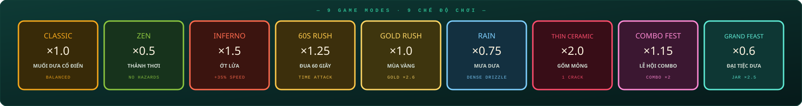
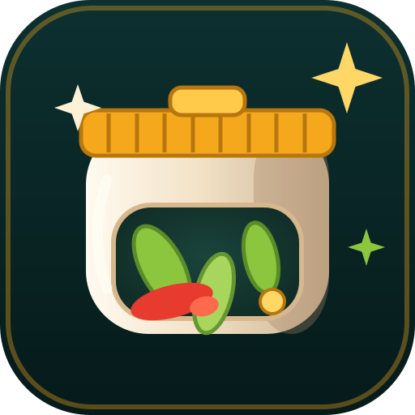

<div align="center">


# LỌ CHÉO — PICKLED JAR SHOWDOWN

### 🫙 เกมอะเคดปีเคิลสัญชาติเวียดนามที่เล่นได้ 100% บนเบราว์เซอร์ — ไฟล์ HTML ไฟล์เดียวจบ ออฟไลน์ได้ทันที
### 🌐 ภาษาในเกม 5 ภาษา — Tiếng Việt · English · 中文 · 日本語 · 한국어

[🇻🇳 Tiếng Việt](README.md) · [🇬🇧 English](README.en.md) · [🇨🇳 中文](README.zh.md) · [🇯🇵 日本語](README.ja.md) · [🇰🇷 한국어](README.ko.md) · [🇪🇸 Español](README.es.md) · [🇫🇷 Français](README.fr.md) · [🇹🇭 ไทย](README.th.md) · [🇩🇪 Deutsch](README.de.md) · [🇵🇹 Português](README.pt.md)

[](docs/releases/v1.1.3.md)
[](LICENSE)
[](#-ติดตั้ง--เริ่มเล่น)
[](#-build-production)
[](#-สลับภาษา)
[](CONTRIBUTING.md)


</div>

---

## 🥒 เกี่ยวกับโปรเจกต์

> Lọ Chéo — Pickled Jar Showdown: เกมอะเคดปีเคิลที่รันได้ 100% บนเบราว์เซอร์ แพ็กมาในไฟล์ HTML เดียวจบ ออฟไลน์เต็มรูปแบบ — ไม่มี CDN ไม่มีเซิร์ฟเวอร์ ไหเซรามิกขยับได้ทาง**เฉียง**เท่านั้น: กดสองปุ่มพร้อมกันเพื่อเอียง เร่งสปีด และเฉือนเชื้อรา แมลงวัน และหนอน แล้วเติมไหให้เต็มก่อนที่เซรามิกจะแตกเป็นสามซีก **7 โหมด · 14 วัตถุดิบ · 14 ความสำเร็จ · ตาราง TOP 8 · อินเทอร์เฟซ 5 ภาษา**

นี่คือ **เกมแอ็กชันจอเดียว** ที่ได้แรงบันดาลใจจากผักดองพื้นบ้านของเวียดนาม ไม่มีด่านเรียงลำดับ ไม่มีเมนูรกรุงรัง มีแค่ไห สายฝนวัตถุดิบที่ไม่สิ้นสุด และรีเฟล็กซ์สุดจี๊ดของคุณ

## 🆕 สิ่งใหม่ใน v1.1.3

- 🌧️ **โหมดใหม่ 2 โหมด** — **พายุผักดอง** (ตกช้าลง ×0.88 แต่หนาแน่นกว่า ~1.4× และอันตรายมากขึ้น ×1.5, ×0.75 คะแนน — ความรู้สึก «น้ำท่วมผักดอง» ที่แสนสุข เลเวลพุ่งไว) และ **เซรามิกบาง** (ร้าวรอยเดียวไหแตก, ×2.0 คะแนน, อันตราย ×1.3 — สำหรับมือเพชรเท่านั้น) รวม **7 โหมด**
- 🏆 **ความสำเร็จใหม่ 2 รายการ** — **พายุฝนถล่ม** (เก็บ 60 ชิ้นในพายุผักดอง) & **เซรามิกเหล็กกล้า** (เติมไหเต็มในเซรามิกบาง) รวม **14 ความสำเร็จ**
- 🌐 **5 ภาษาในเกม** — เพิ่ม **日本語 (日)** และ **한국어 (한)** ควบคู่ VI/EN/中文: 193 คีย์ต่อภาษา, ซิงก์ `<html lang>`, ตัวเลขตาม locale (vi-VN / en-US / zh-CN / ja-JP / ko-KR)
- 🚀 **ตัวเปิดหลายภาษามีแอนิเมชัน** — ตัวเปิดทั้งสาม (`play-linux.sh` · `play-mac.command` · `play-windows.bat`) สลับภาษาด้วยปุ่ม `L` (VI→EN→中文) รองรับ `LOCHEO_LANG`, มีแบนเนอร์กระพริบ 3 ครั้ง สปินเนอร์เบรลพร้อม % จริง และเอฟเฟกต์ประกาย — เมนูเวียดนามมี**เครื่องหมายวรรณยุกต์ครบถ้วน** ดู [scripts/README.md](scripts/README.md)
- ⭐ **favicon ใหม่** `favicon.ico` (หลายขนาด 16→256 px) + `assets/favicon.svg` แบบแอนิเมชัน (SMIL) & `public/` — พร้อมใช้บนเว็บ สวยทุกแท็บ
- 🐛 **กวาดบั๊กทั้งหมด** (ดู [CHANGELOG](CHANGELOG.md) `[1.1.3]`); `npm run check` เขียวด้วย **55 การทดสอบหน่วย**



<div align="center"></div>

→ รายละเอียดทั้งหมด: [docs/releases/v1.1.3.md](docs/releases/v1.1.3.md)

## ✨ จุดเด่น

| หมวด | รายละเอียด |
| --- | --- |
| 🎮 **7 โหมด** | **ดองคลาสสิก**(สมดุล) · **ZEN**(ไม่มีอันตราย, ×0.5) · **อินเฟอร์โนพริก**(เร็ว +35%, ×1.5) · **60 วินาที**(time-attack 60s, ×1.25) · **โกลด์รัช**(ของทองหล่น ×2.6) · **พายุผักดอง**(หนาแน่น ~1.4×, ×0.75) · **เซรามิกบาง**(ร้าวรอยเดียวจบ, ×2.0) |
| 🌐 **i18n ในเกม** | Tiếng Việt · English · 中文 · 日本語 · 한국어 — `src/i18n/` (โมดูลล้วน + สะพาน React), `t()` รองรับ interpolation ซิงก์ `<html lang>` ตัวเลขตาม locale (vi-VN / en-US / zh-CN / ja-JP / ko-KR) |
| 🕹️ **กลไก CHÉO เฉพาะ** | กด 2 ปุ่ม/แกนแบบเฉียง — ไหเร่งสปีด เรืองแสง และเฉือนอันตราย มีหลอด stamina แยก พร้อม hysteresis กันกระพริบ |
| 🥬 **14 วัตถุดิบ** | มะเขือ พริก กระเทียม ขิง เกลือ ผัก · **ผักทอง** (เติมไหเร็ว) · เกลือ/กระเทียมทอง · พริกเพลิง · น้ำแข็ง · เชื้อรา แมลงวัน **หนอน** (อันตราย) |
| 🧄 **เกราะกระเทียมทอง** | พาวเวอร์อัพ: สะสมได้สูงสุด **2 ชาร์จ** กันรอยร้าว มีรัศมีหมุนโคจรรอบไห |
| 🏆 **14 ความสำเร็จ** | บันทึกข้ามรอบ (localStorage) พร้อม toast «ความสำเร็จใหม่!» บนหน้าจบเกม |
| 🔊 **ซาวด์ทำมือ** | เอฟเฟกต์ 11 แบบสังเคราะห์ด้วย Web Audio API (ไม่มีไฟล์) + บันไดเสียง pentatonic เปลี่ยนตามเลเวล กด `M` ปิดเสียง |
| 💾 **ตาราง TOP 8** | เก็บลงเครื่อง ตรวจสอบ/ปรับค่าเมื่ออ่าน ชื่อตัวพิมพ์ใหญ่ ไฮไลต์สถิติใหม่ |
| 🎨 **กราฟิก 60fps** | Canvas 2D งบอนุภาค ≤460 จำกัด DPR ≤ 2 พื้นกระเบื้องพรีเรนเดอร์ลง offscreen ดาวระยิบ + ออโรร่าในเมนู |
| 📴 **ออฟไลน์จริง** | ฟอนต์โฮสเอง (subset latin + vietnamese woff2) ไม่มี CDN ไม่มี API — ดับเบิลคลิก `dist/index.html` แล้วเล่นได้เลย |
| 🧪 **คุณภาพ** | 55 เทสต์ (vitest) ครอบคลุม modes / achievements / storage / i18n — `npm run check` คือประตู CI |


## 🌐 สลับภาษา

Lọ Chéo มาพร้อม **อินเทอร์เฟซ 3 ภาษา** เปลี่ยนแล้วมีผลทันที — ไม่ต้องรีโหลด ไม่เสียรอบที่เล่นอยู่:

| ภาษา | อยู่ตรงไหน | เก็บไว้ที่ |
| --- | --- | --- |
| 🇻🇳 Tiếng Việt | ปุ่ม **VI** (ค่าเริ่มต้น ตาม locale เบราว์เซอร์) | `locheo.lang.v1` |
| 🇬🇧 English | ปุ่ม **EN** | `locheo.lang.v1` |
| 🇨🇳 中文 | ปุ่ม **中** | `locheo.lang.v1` |
| 🇯🇵 日本語 | ปุ่ม **日** | `locheo.lang.v1` |
| 🇰🇷 한국어 | ปุ่ม **한** | `locheo.lang.v1` |

- สลับจาก **เมนูหลัก** (มุมขวาบน) หรือ **หน้าหยุดชั่วคราว** (ด้านล่าง โหมดย่อ)
- string ทุกตัวที่ผู้ใช้เห็นอยู่ใน `src/i18n/locales/{vi,en,zh,ja,ko}.ts` — canvas engine, screens, HUD, popup, ticker, คำแนะนำ
- ขาด key? `t()` จะ fallback เป็นภาษาเวียดนาม — ชุด key ทั้งห้าภาษาถูกบังคับโดยเทสต์

## 🕹️ การควบคุม

| การกระทำ | คีย์บอร์ด | ทัช |
| --- | --- | --- |
| เคลื่อนที่ | `W` `A` `S` `D` หรือ `← ↑ ↓ →` | ลากตรงไหนก็ได้ (floating joystick) |
| **เอียง (CHÉO)** | กดค้าง **2 ปุ่มพร้อมกัน** (เช่น `A`+`W`) | ลากที่ **45°** — วงแหวนจอยสติ๊กเปลี่ยนเป็นทอง |
| กระแทกไห (ช็อกเวฟ + ดูดเข้า) | `Space` | ปุ่ม **SLAM** สีแดง มุมขวาล่าง |
| หยุดชั่วคราว / เล่นต่อ | `P` หรือ `Esc` | ปุ่มหยุด มุมขวาบน |
| รีสตาร์ตทันที | `R` (แม้กำลัง paused/game-over) | ปุ่ม "Pickle again" |
| เริ่ม / ยืนยัน | `Enter` | ปุ่ม **ENTER THE KITCHEN** |
| ปิด/เปิดเสียง | `M` | ปุ่มลำโพง มุมขวาบน |
| สลับภาษา | — (ใช้ปุ่ม VI/EN/中/日/한) | ปุ่ม VI/EN/中/日/한 ในเมนู / pause |

## 🚀 ติดตั้ง & เริ่มเล่น

### เล่นได้เลย (ไม่ต้อง build)

```bash
# ทุก release แจกไฟล์เดียวจบ:
open dist/index.html      # macOS
xdg-open dist/index.html  # Linux
start dist/index.html     # Windows
```

### Build Production

```bash
npm install        # ติดตั้ง dependency (Node ≥ 20.19)
npm run build      # → dist/index.html (ไฟล์เดียวจบ)
```

> `vite-plugin-singlefile` ยัด JS/CSS/ฟอนต์/รูปทั้งหมดลง **ไฟล์เดียว** `dist/index.html` (~655 KB, gzip ~330 KB) ไม่ต้องมีเซิร์ฟเวอร์ ไม่ต้องมีเน็ต

### Development

```bash
npm run dev        # dev server พร้อม HMR (http://localhost:5173)
npm run preview    # เสิร์ฟ production build ในเครื่อง
npm run typecheck  # tsc --noEmit (strict, noUnusedLocals…)
npm run test       # vitest — 55 เทสต์ (modes / achievements / storage / i18n)
npm run check      # typecheck + test + build (ประตูคุณภาพ CI)
```

## 🗂️ โครงสร้างโปรเจกต์

```
lo-cheoio/
├─ index.html              # entry, SEO/OG meta (ไม่มี CDN)
├─ package.json            # lo-cheoio v1.1.3, สคริปต์ dev/build/test/check
├─ vite.config.ts          # vite + react + tailwind v4 + singlefile
├─ tsconfig.json           # strict; ครอบคลุม src + tests
├─ favicon.ico             # web icon (multi-size 16→256)
├─ public/                 # favicon.ico/png/svg served at web root
├─ assets/
│  ├─ banner.svg           # แบนเนอร์ README (SMIL animation)
│  ├─ demo.svg             # จำลอง gameplay (SMIL animation)
│  ├─ items.svg            # 14 วัตถุดิบ (SMIL animation)
│  ├─ modes.svg            # 7 โหมด (SMIL animation)
│  ├─ license.svg          # ตรา copyleft AGPL-3.0 แบบเคลื่อนไหว (SMIL animation)
│  └─ favicon.svg          # favicon (SMIL animation)
├─ scripts/
│  ├─ play-mac.command     # ตัวเปิด macOS — ดับเบิลคลิก เมนูสีสันจัดเต็ม
│  ├─ play-windows.bat     # ตัวเปิด Windows — ดับเบิลคลิก เมนูสีสันจัดเต็ม
│  ├─ play-linux.sh        # ตัวเปิด Linux — ดับเบิลคลิก เมนูสีสันจัดเต็ม
│  └─ README.md            # คู่มือตัวเปิดสำหรับคนไม่ถนัดเทอร์มินัล
├─ docs/
│  ├─ DESCRIPTION.md       # บล็อกแนะนำโปรเจกต์หลายภาษา (vi/en/zh + SEO)
│  └─ releases/
│     ├─ v1.0.0.md         # release notes ฉบับแรก
│     ├─ v1.1.0.md         # release notes v1.1.0
│     ├─ v1.1.1.md         # release notes v1.1.1
│     ├─ v1.1.2.md         # v1.1.2
│     └─ v1.1.3.md         # release notes ปัจจุบัน (1.1.3)
├─ README.md               # 🇻🇳 Tiếng Việt
├─ README.en.md            # 🇬🇧 English
├─ README.zh.md            # 🇨🇳 中文
├─ README.ja.md            # 🇯🇵 日本語
├─ README.ko.md            # 🇰🇷 한국어
├─ README.es.md            # 🇪🇸 Español
├─ README.fr.md            # 🇫🇷 Français
├─ README.th.md            # 🇹🇭 ไทย (ไฟล์นี้)
├─ README.de.md            # 🇩🇪 Deutsch
├─ README.pt.md            # 🇵🇹 Português
├─ src/
│  ├─ main.tsx             # React root, StrictMode
│  ├─ App.tsx              # phase machine menu/playing/paused/gameover
│  ├─ version.ts           # APP_VERSION = "1.1.3" (แหล่งความจริงเดียว)
│  ├─ index.css            # tailwind v4 theme + แอนิเมชัน/ gradient ทั้งหมด
│  ├─ assets/fonts/        # woff2 subsets (Be Vietnam Pro ×6, Bungee)
│  ├─ styles/fonts.css     # @font-face + unicode-range, ออฟไลน์ 100%
│  ├─ i18n/
│  │  ├─ i18n.ts           # โมดูลล้วน: detect, persist, t() + interpolation
│  │  ├─ useI18n.ts        # React hook: useI18n/useLanguage
│  │  └─ locales/          # vi.ts (แหล่ง key) · en · zh · ja · ko
│  ├─ components/
│  │  ├─ GameCanvas.tsx    # canvas + floating joystick + keyboard + visibility
│  │  ├─ StartScreen.tsx   # เมนู: ออโรร่า shimmer ตัวเลือกโหมด ความสำเร็จ
│  │  ├─ ModeSelector.tsx  # การ์ด 7 โหมด (classic/zen/inferno/blitz/goldrush/storm/hardcore)
│  │  ├─ AchievementsPanel.tsx  # กำแพงป้าย locked/unlocked
│  │  ├─ GameOverScreen.tsx     # ไหแตก! + คะแนน + ความสำเร็จใหม่
│  │  ├─ PauseScreen.tsx        # หยุดชั่วคราว + สถิติรอบนี้
│  │  ├─ LanguageSwitcher.tsx   # สวิตช์ VI / EN / 中 / 日 / 한 ที่ใช้ร่วมกัน
│  │  └─ ui.tsx            # GameButton, Panel, Keycap, Stat, ScoreBoard…
│  ├─ game/
│  │  ├─ engine.ts         # การจำลอง + เรนเดอร์ canvas ทั้งหมด (~2100 บรรทัด)
│  │  ├─ modes.ts          # โหมดเกม + สมดุล (pure)
│  │  ├─ achievements.ts   # 14 ป้าย + ตัวตรวจ (pure)
│  │  ├─ storage.ts        # localStorage: top 8, progress, achievements
│  │  └─ audio.ts          # Web Audio synth: sfx + เพลง pentatonic
│  └─ utils/cn.ts          # clsx + tailwind-merge
└─ tests/                  # vitest — modes, achievements, storage, i18n
```

## 🧱 สถาปัตยกรรม & ประสิทธิภาพ

- **Game loop** บน `requestAnimationFrame` delta-time จำกัดที่ `1/20s` คูณ `timeScale` (สโลว์โมชันจากน้ำแข็ง) และ **hit-stop** แช่แข็งสั้น ๆ ทุกครั้งที่รับของ ให้ความรู้สึก "หนักแน่น"
- **Canvas HUD** วาดตรงทุกเฟรม React เรนเดอร์เฉพาะหน้าจอตาม `phase` — ไม่มี re-render ในลูปร้อน เมื่อเปลี่ยนภาษา HUD หยิบ dictionary ใหม่เฟรมถัดไปทันที
- **i18n แบบชั้น**: `src/i18n/i18n.ts` เป็นโมดูลล้วน (ไม่พึ่ง React) `useI18n` เพียงสะพาน re-render ผ่าน event `locheo:languagechange`; `t()` รองรับ `{param}` interpolation และ fallback เป็นภาษาเวียดนาม
- **พื้นกระเบื้อง** พรีเรนเดอร์ครั้งเดียวลง offscreen canvas (พร้อม vignette + แอ่งแสง) ดาวระยิบและฟองคำนวณแบบเรียลไทม์ — ถูกมาก
- **Budget**: ≤460 อนุภาค ≤70 ไอเทม ≤34 popup DPR ≤ 2; กวาด hitbox collision; รอยดองที่พื้นล้างตัวเองได้
- **localStorage** ตรวจ/ปรับข้อมูลเมื่ออ่าน — เรคคอร์ดเสียหนึ่งรายการไม่ทำตารางพัง; ถ้า storage ถูกบล็อก (Safari โหมดส่วนตัว) เกมเล่นต่อในหน่วยความจำ; ตัวเลือกภาษาแยกไว้ใน `locheo.lang.v1`
- **Motion chill**: `prefers-reduced-motion` ปิดออโรร่า/shimmer/การหมุน; ทั้งดาวพื้นหลังและหน้าจอเขย่าเคารพ media query

## ❓ FAQ

**เล่นแบบไม่มีเน็ตได้ไหม?**
ได้ 100% — เปิด `dist/index.html` แล้วทุกอย่างทำงาน รวมฟอนต์และเสียง ไม่มี request ออกนอกเครื่องเลยแม้แต่ครั้งเดียว

**มีโฆษณาหรือ telemetry ไหม?**
ไม่มี ไม่มี tracking ไม่มี analytics — คะแนนของคุณไม่เคยออกจาก localStorage

**เปลี่ยนภาษาแล้วความคืบหน้าหายไหม?**
ไม่หาย คะแนน ความสำเร็จ progress และโหมดที่เลือก ทั้งหมดแยกจาก `locheo.lang.v1`

**คะแนน TOP 8 เก็บไว้ที่ไหน?**
`locheo.scores.v1` (คะแนน), `locheo.progress.v1` (จำนวนรอบ/ไห/การเฉือนรวม), `locheo.achievements.v1` (ป้าย) — ล้าง storage คือหายหมด ดังนั้นรักษาไหของคุณไว้!

**อยากเพิ่มภาษาอื่น?**
เพิ่ม `src/i18n/locales/xx.ts` ให้ mirror ชุด key ของ `vi.ts` อัปเดต `LANGUAGES` + tests แล้วเปิด PR — ดู [CONTRIBUTING.md](CONTRIBUTING.md)

**ไม่ถนัดเทอร์มินัล?**
ดับเบิลคลิก [`scripts/play-mac.command`](scripts/play-mac.command) (macOS), [`scripts/play-windows.bat`](scripts/play-windows.bat) (Windows) หรือ [`scripts/play-linux.sh`](scripts/play-linux.sh) (Linux) — เมนูสีสันจะเปิดขึ้น เลือก `1` เพื่อ build & เล่นทันที หรือ `2` สำหรับ dev server รายละเอียด: [scripts/README.md](scripts/README.md)

## 📦 รีลีส & เช็งต์ล็อก

| เวอร์ชัน | วันที่ | บันทึก |
| --- | --- | --- |
| [v1.1.3](docs/releases/v1.1.3.md) | 2026-11-12 | 7 โหมด (พายุผักดอง · เซรามิกบาง) · 14 ความสำเร็จ · 5 ภาษา · favicon · ตัวเปิดหลายภาษา · 55 เทสต์ |
| [v1.1.2](docs/releases/v1.1.2.md) | 2026-11-12 | 5 โหมด (60-Second Rush · Gold Rush) · 12 ความสำเร็จ · คอมโบไฟ · ตัวเปิดดับเบิลคลิก · README 10 ภาษา · 49 เทสต์ |
| [v1.1.1](docs/releases/v1.1.1.md) | 2026-11-12 | i18n ในเกม VI/EN/ZH · README 7 ภาษา · กวาดบั๊กทั้งหมด · 45 เทสต์ |
| [v1.1.0](docs/releases/v1.1.0.md) | 2026-11-12 | 3 โหมด · เกราะกระเทียมทอง · หนอน · ผักทอง · 10 ความสำเร็จ · ฟอนต์โฮสเอง |
| [v1.0.0](docs/releases/v1.0.0.md) | 2026-10-26 | รีลีสแรก: เอนจินครบ 11 วัตถุดิบ JAR SLAM ×9 คอมโบ |

ดูเพิ่มเติมที่ [CHANGELOG.md](CHANGELOG.md)

## 🤝 ร่วมพัฒนา

1. Fork repo แล้วแตก branch ตามรูปแบบ `arena/<name>` หรือ `feat/<name>`
2. `npm run check` ต้องเขียวก่อนเปิด PR (typecheck + 55 เทสต์ + build)
3. เลี่ยงการเพิ่ม dependency ตอน runtime ถ้าไม่จำเป็นจริง ๆ — ปรัชญา: **ไฟล์เดียว ไม่มีเน็ต เล่นได้ตลอดกาล**
4. ใน PR ระบุหน้าจอ/โหมดที่ได้รับผลกระทบ และแนบคลิปถ้ามีการเปลี่ยน gameplay

## 📄 สัญญาอนุญาต & ผู้สร้าง


- **AGPL-3.0-only** © 2026 [Standardize Paradigm](mailto:standardizeparadigm@donuco.com) — ดู [LICENSE](LICENSE) และ [assets/license.svg](assets/license.svg)
- ฟอนต์: [Be Vietnam Pro](https://fonts.google.com/specimen/Be+Vietnam+Pro) & [Bungee](https://fonts.google.com/specimen/Bungee) — SIL Open Font License 1.1 (โฮสเองเป็น woff2 subsets)
- ขออุทิศให้ไหดองทุกใบบนสำรับข้าวเวียดนามทุกจาน — ชนแก้ว 🫙🇻🇳
